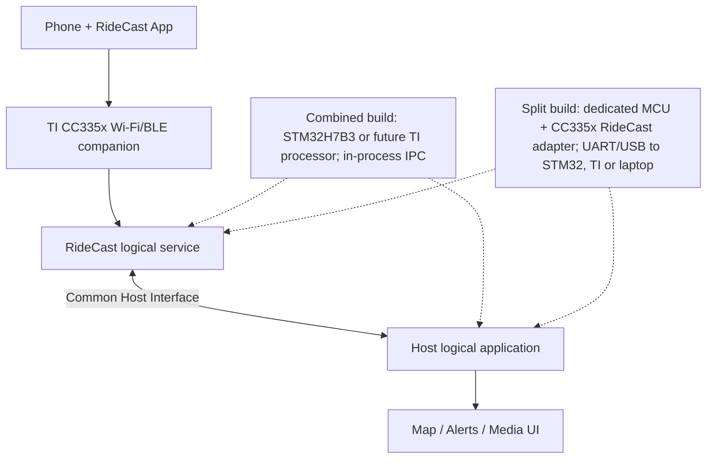
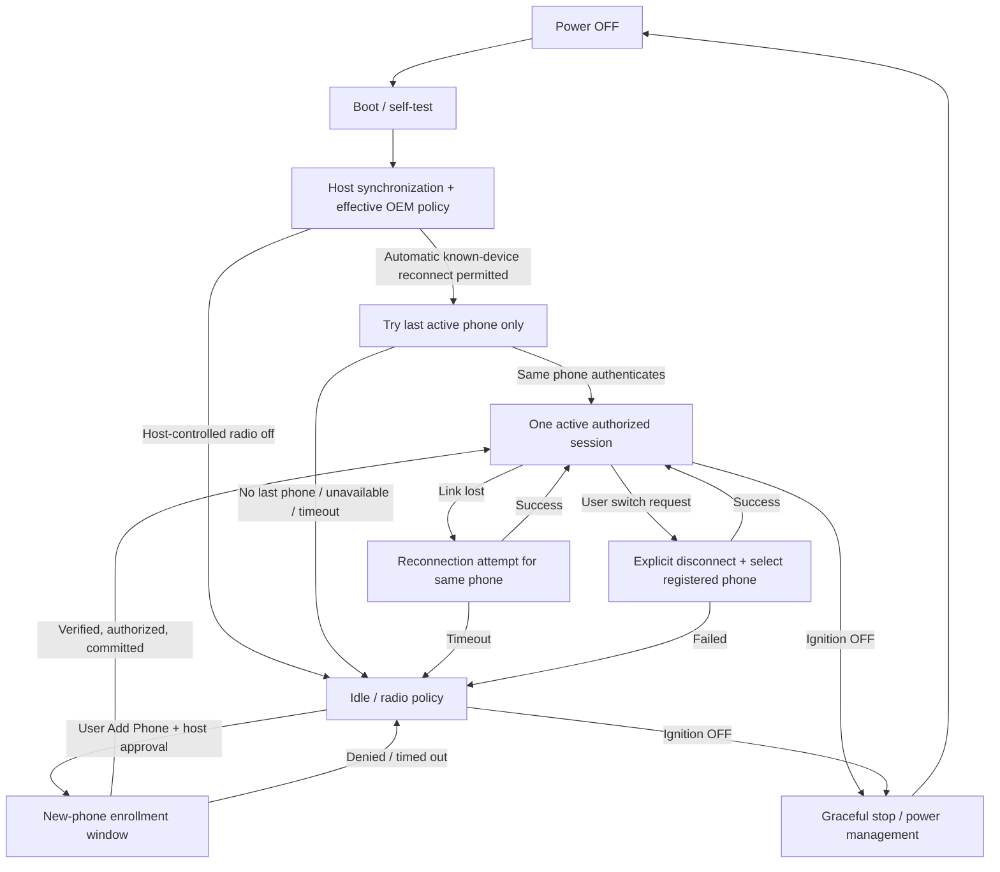
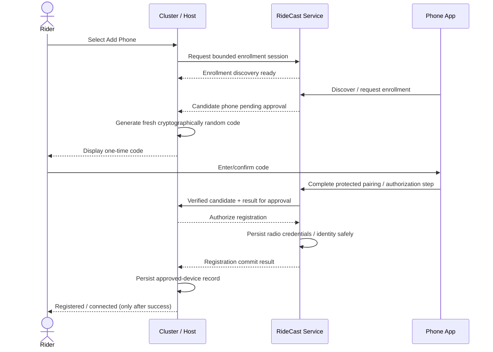

# 02 — RideCast Product Flows & OEM Interaction Scenarios

> **Document type:** Product behavior, OEM integration scenarios, and future-development handoff  
> **Version:** 0.2 — first written scenario baseline  
> **Date:** 2026-11-05  
> **Status:** **Discussion baseline, not a finalized implementation or protocol specification**  
> **Audience:** OEM product owners, cluster/UI teams, RideCast firmware teams, mobile-app teams, testers, and future AI assistants  
> **Related document:** [`01_RIDECAST_ARCHITECTURE_PLAN.md`](./01_RIDECAST_ARCHITECTURE_PLAN.md)  
> **Next proposed document:** `03_RIDECAST_HOST_INTERFACE.md` — to be designed after the product flows are reviewed

---

## 0. Executive summary — read this first

**RideCast is a black-box wireless connectivity product/service for vehicle clusters.** It bridges an authorized phone and a host (vehicle cluster, TI MPU, STM32 board, or laptop test application). **RideCast does not draw a map, render notifications, or play audio.** The *host* handles user-facing UI, maps, notification presentation, and media widgets. The phone supplies permitted location/navigation, notification/chat-alert, and media metadata through a companion app or another explicitly supported integration.

**Critical architectural idea:** The *RideCast role* and *Host role* are **always logically separate**, but may run (a) on a single STM32H7B3/TI processor with internal IPC, or (b) on separate processors with UART initially and optionally USB later. Product flow, authorization semantics, and the eventual Host Interface must stay consistent across both modes.

**This document defines behavior, NOT old code or an inherited packet protocol.** Earlier RideCast framing, commands, code, PIN schemes, and byte values are not binding in this new planning exercise. After product flows are agreed, define the new transport-neutral interface in Document 03. Document 01 remains the architectural background; where its older protocol implementation assumptions or preferred-phone policy conflict with this document, **the newer explicit decisions recorded here take precedence for product behavior**.

### Decisions explicitly agreed in discussion

| ID | Product decision | Status |
|---|---|---|
| D01 | **Hybrid wireless startup**: host/OEM policy governs automatic reconnection to an already-authorized phone | **Agreed** |
| D02 | **Every new phone registration requires cluster approval and a fresh cluster-generated, displayed PIN/code** | **Agreed** |
| D03 | **Returning registered phone reconnects securely without another PIN** while its credentials and authorization remain valid | **Agreed** |
| D04 | **Multiple phones may be registered, but only one may be the active content source** | **Agreed** |
| D05 | **Last successfully active phone first and only for automatic connection**; no owner/preferred-phone priority; **no automatic fallback** to another registered phone | **Agreed — supersedes earlier preferred-phone proposal** |
| D06 | Switching to a different registered phone is **user-initiated**, by disconnecting/switching through an authorized UI/process | **Agreed intent**; initiator permissions still to settle |
| D07 | An authorized phone app may change **settings explicitly permitted by OEM policy directly**, without per-change cluster approval; cluster is informed/synchronized | **Agreed** |
| D08 | **No-phone idle / radio timeout is OEM-selectable**, subject to security and hardware constraints | **Agreed** |
| D09 | Normal power-off must **retain valid registrations and last-connected selection** | **Agreed intent** |

**Not yet decided:** numeric timeouts, capacity (maximum registered phones), BLE/Wi-Fi transport policy, exact passkey/security mechanism, priority for host/app simultaneous setting changes, default OEM policy values, how a user switches phones, and production security provisioning. Proposed examples below are *not* final requirements.

---

## 1. Actors, ownership, and product boundary

| Actor | Owns | Must not assume |
|---|---|---|
| **OEM / manufacturer** | Product capability profile, allowed settings, radio startup/idle policy, safety and update requirements | All vehicle models need identical idle behavior |
| **Host / cluster** | Vehicle UI, user initiation/consent for new registration, cluster-generated enrollment code, registered-device policy, selection of active phone, connectivity policy, shutdown decision | Wireless association alone means a phone is trusted |
| **RideCast service/adapter** | Hardware radio control, wireless secure connection and credentials, verified phone identity, enforcement of OEM/host permissions, status, bounded forwarding | It owns the cluster screen or GPS source |
| **Phone companion app** | Discovery, permitted content sharing, user-entered enrollment code, allowed settings requests, phone platform permissions | Bluetooth/Wi-Fi automatically reveals all phone data |
| **User / rider** | Explicit Add Phone, Switch Phone, Disconnect, Forget Phone and approved settings operations | Powering on means discoverable enrollment is automatically open |

### Physical configurations — same product behavior

The selected CC335x variant and host driver must support the desired Wi-Fi and/or BLE feature. CC335x is a wireless companion, **not the application MCU**. A future low-cost STM32G0 host for CC335x is a candidate only until resource and driver feasibility are proven.

### Product invariants (must remain true)

1. **No unauthorized phone becomes an active source** of location, notifications, or media.
2. **Only one active phone** supplies user content at a time, even if multiple registrations exist.
3. **Only the last successfully active phone** is attempted automatically. An unavailable last phone **does not trigger auto-selection of another known phone**.
4. **New enrollment always requires host/cluster approval and a fresh cluster-generated displayed code** (or a separately approved accessibility/service enrollment interface if no display exists; such alternatives are *not* in this baseline).
5. A returning phone must **prove cryptographic identity**; name, advertising data, MAC address, and a saved phone label do not prove ownership.
6. OEM policy and security restrictions take precedence over app preferences. Phone-app direct changes operate only within an explicit **allowlist**.
7. Host and RideCast exchange **actual status/results**, not optimistic assumptions that a request succeeded.
8. Startup, pairing, timeout, error, and shutdown semantics remain the same in combined and split deployments.
9. Secret credentials are protected; PINs/passwords/keys must not be printed in ordinary logs or forwarded to untrusted clients.
10. Radio enabled, advertising/discoverable, wireless-link connected, authenticated, and **active content session** are distinct conditions.

---

## 2. Conceptual operating model

A single state enum is insufficient to represent Wi-Fi, BLE, authentication, and vehicle host availability. A real implementation should model at least **independent dimensions**:

| Dimension | Example conditions |
|---|---|
| Power/service | OFF, BOOTING, READY, SHUTTING_DOWN, FAULT |
| Host link | NOT_READY, SYNCHRONIZING, READY, LOST |
| BLE | OFF, ON_NOT_ADVERTISING, ADVERTISING_KNOWN, PAIRING_DISCOVERABLE, LINK_CONNECTED |
| Wi-Fi | OFF, INITIALIZING, READY, CLIENT_ASSOCIATED |
| Enrollment | CLOSED, OPEN, PENDING_CLUSTER_APPROVAL, AUTHENTICATING, COMMITTING |
| Phone session | NONE, RECONNECTING_LAST, AUTHENTICATED_INACTIVE, ACTIVE, DISCONNECTING |
| User content | Location / notification / media individually AVAILABLE, STALE, UNAVAILABLE |

**Don't equate:** BLE connected ≠ paired/authorized ≠ active phone; Wi-Fi joined ≠ application authenticated; link up ≠ GPS permission available.

### Top-level lifecycle, simplified

This drawing describes user-visible lifecycle only; failure and asynchronous host/radio events are handled in the scenarios below.

---

## 3. Scenario catalog (what an OEM should be able to test)

Each scenario describes: **preconditions → trigger → actions → expected outcome → failure behavior**. They are written as product-level requirements, deliberately avoiding command opcodes, APIs, packet layouts, queue names, or Zephyr details.

### S01 — First vehicle power-on, no phone registered

**Preconditions:** New vehicle / cleared user credentials; RideCast and host power available.

**Trigger:** Ignition ON / approved power-up condition.

**Step-by-step:**

1. Host boots its vehicle application. RideCast boots its service, performs a self-test, and loads valid persistent configuration.
2. Both roles establish a trusted Host Interface (or in-process equivalent) and exchange readiness, capabilities, and current actual state.
3. OEM policy is selected/applied; any autonomous behavior before host readiness must be explicitly permitted by a stored trusted policy.
4. RideCast finds **no registered phone** and reports that condition.
5. The host displays **Add Phone** or equivalent guidance; RideCast **does not** silently enroll any unknown phone.
6. If the rider chooses Add Phone, continue to S03; otherwise apply the configured idle/power policy (S11).

**Outcome:** No unauthorized content access or automatic enrollment. Host UI remains usable without a phone.

**Failure path:** Missing/corrupt policy or failed secure storage → fail safely; do not advertise open pairing or use a default secret without controlled provisioning.

### S02 — Subsequent ignition ON with a registered last-connected phone

**Preconditions:** Phone B is recorded as the **last successfully active phone**, has a valid registration and wireless credentials, and reconnection is permitted by current policy.

1. Vehicle/host starts and RideCast reports ready and synchronized policy.
2. RideCast loads the saved identifier for **Phone B** and enables only the wireless functions necessary for the permitted reconnection attempt.
3. RideCast attempts **Phone B only**; it does not automatically try Phones A or C.
4. Phone B establishes an encrypted, cryptographically authenticated connection with valid credentials.
5. RideCast reports the verified phone identity; the host/policy verifies it is still authorized and eligible to be active.
6. RideCast marks Phone B as **active** and reports actual status to host and app.
7. The host displays connected state and consumes permitted content once that feature is available.

**Outcome:** No new PIN. Saved `last_active_phone` remains B. If B fails to connect, go to S06/S11; don't choose another phone automatically.

### S03 — First-time enrollment of a new phone, cluster-generated code

**Preconditions:** No enrollment session in progress; host/display is ready; user has explicitly requested Add Phone; policy allows enrollment (e.g., parked/authorized state).

**Security interpretation:** The host generates the *user-visible authorization code*. The design of BLE Secure Connections passkey/numeric comparison **versus** application-layer enrollment proof is still open. A six-digit number alone is **not** sufficient to claim a secure, bonded connection; protect the exchange against impersonation, brute force and replay. Both endpoints must agree on a verified identity and registration result; avoid an authorization gap if only one side successfully saves credentials.

**Timeouts/failures:** Cancel/deny, too many wrong attempts, code expiry, radio loss, host loss, or storage failure → expire this registration attempt; no partially authorized device remains active. Close public enrollment visibility according to policy.

### S04 — Returning phone reconnects after ignition or temporary loss

**Preconditions:** Previously registered phone, unchanged valid credentials, not revoked, selected as last active or explicitly selected by user.

1. Connection resumes using saved **secure credentials**.
2. RideCast verifies the actual device identity and cryptographic proof; **no new code** is shown.
3. Host authorization is checked or restored from trusted, synchronized policy; capability restrictions are reapplied.
4. Only then does RideCast resume forwarding personal content.
5. If phone credentials were deleted on the phone, changed unexpectedly, or revoked on the vehicle, require a new approved enrollment (S03).

**Outcome:** Reconnection is automatic only for the eligible last-active phone; cryptographic trust never comes from a friendly name alone.

### S05 — Multiple registered phones nearby, last-connected-only rule

**Preconditions:** Phones A (owner), B (family), C (friend) registered. **Phone B was last active.**

| Nearby devices | Automatic choice | Explanation |
|---|---|---|
| A + B + C | **B** | Last active wins, irrespective of owner/name |
| B only | **B** | Expected normal reconnection |
| A + C, B absent | **None** | No automatic fallback |
| A only, B absent | **None** | Rider must explicitly switch to A |
| A arrives after B becomes active | **Stay on B** | No automatic preemption |
| B drops temporarily | Retry **B** within policy | Keep other saved registrations unchanged |

**Important:** Registered ≠ active. The selected phone must authenticate; one device is the source of location/navigation, notifications and media information. Additional simultaneous secure links, if hardware supports them, do not grant additional active content streams by default.

### S06 — Last-connected phone unavailable

1. RideCast attempts the stored last-active phone under the OEM-configured reconnect window.
2. No valid connection is made.
3. RideCast reports **last phone unavailable / reconnection timed out** to host.
4. It **does not** connect another registered phone automatically, even if that phone is physically nearby.
5. OEM policy selects whether the radio waits, performs a later bounded retry, stays in a known-device low-power mode, or stops.
6. Rider can invoke **Switch Phone** / **Connect Registered Phone** (S07), subject to host UI and security policy.

**Outcome:** `last_active_phone` is **not modified by timeout or failed attempts**.

### S07 — User explicitly switches to a different registered phone

**Example:** Phone B is last active; rider requests Phone A.

1. An authorized UI (host cluster or, if OEM allows, an authenticated phone app) requests a **user-initiated switch**.
2. Host/RideCast verify this request is allowed in the current vehicle state.
3. If B is active, RideCast stops B's personal-content stream and disconnects/deactivates B as required.
4. RideCast attempts **only the explicitly selected Phone A**, using A's stored credentials.
5. If A authenticates and host policy authorizes it, A becomes the sole active phone; report success to host and app.
6. **Only after successful activation**, persist `last_active_phone = A`.
7. On subsequent ignition ON, auto-reconnect targets A.

**Failure:** If A cannot connect, never update `last_active_phone`. Whether to restore B automatically **after a failed user switch** is an *open product decision*; avoid silently switching back unless agreed. At minimum, report the failed switch and provide explicit retry/disconnect options.

### S08 — Active phone disconnects or moves out of range

1. RideCast detects link/session loss, stops accepting content from that session and informs host.
2. Host changes active display state to disconnected; it should not continue showing stale data as live.
3. Reconnect attempts target the **same last-active phone only**, within OEM limits.
4. Valid reconnection restores active content without a new PIN.
5. After timeout, apply OEM idle policy; registrations remain stored.

**No autonomous switch** to another registered phone occurs.

### S09 — Authorized phone app modifies permitted settings directly

**Examples:** BLE display name, authorized Wi-Fi SSID, phone-visible label, preferences, auto-connect option within OEM bounds.

1. Phone has a verified **authorized active session** with the permissions required for this specific setting.
2. App submits requested setting and receives a clear pending/accepted/rejected result.
3. RideCast checks the *effective OEM + host policy* and validates ranges/characters, credential handling and any required privilege.
4. If permitted, RideCast applies a safe settings transaction, saves persistent state as appropriate and updates the actual configuration.
5. RideCast informs the cluster of **what actually changed**, with revision and effective status; the host updates its settings UI.
6. Where radio names/credentials force reconnect, RideCast provides advance warning and a recovery path before disrupting the live link.

**No per-change cluster approval** for whitelisted settings. **Not allowed** as an ordinary direct app change: disabling security minimums, registering a new unknown phone, unilaterally revoking another owner's access, bypassing vehicle safety restrictions or unapproved factory reset.

**Concurrence rule TBD:** Define revision/conflict behavior when cluster and phone both request a setting change at nearly the same time. Don't rely on racing writes or silent last-writer-wins for sensitive settings.

### S10 — Cluster/host changes settings or wireless service state

1. OEM/user changes a policy or permitted setting on host UI.
2. Host sends the request to RideCast and receives an **actual** apply result, including unsupported/invalid/busy/error cases.
3. RideCast updates radio behavior or settings only within hardware and security constraints.
4. Host updates its UI from the response/status, not merely from the request.
5. If policy disables a radio or session, RideCast closes the affected connection safely, without deleting registrations unless explicitly requested.

Separate controls/statuses should exist for **radio enabled**, **advertising/discovery**, **Wi-Fi mode**, **authenticated session**, and **active phone**. BLE device naming is not a Wi-Fi-style password.

### S11 — No-phone / inactivity timeout; OEM-selectable idle behavior

1. No authorized active phone connects before a policy-defined deadline, or the current session disconnects and its reconnection window expires.
2. RideCast reports timeout and enters an **effective OEM-selected idle mode**: (a) radios off, host link available; (b) reduced known-device discovery; or (c) continued limited background connectivity where permitted.
3. New-phone enrollment never remains unrestricted merely because the radio is enabled.
4. Host can request resume/reconnect or user Add Phone; behavior is enforced with security policy.
5. Last-active choice and valid bonds survive the idle transition.

**Numbers not yet fixed:** reconnection window, pairing window, idle timeout, per-radio dwell times and power budget. OEM profiles will choose supported values; production designs must validate standby current and wake-up latency.

### S12 — Ignition OFF / normal shutdown

1. Host begins controlled shutdown and requests RideCast to stop content, discovery, and wireless sessions.
2. RideCast stops new phone-data forwarding and closes current connections.
3. Pending settings/registration transactions either commit completely or roll back safely.
4. RideCast acknowledges achieved state where power remains long enough to do so.
5. Radio and RideCast MCU enter the required low-power/off state; vehicle hardware may remove supply.
6. **Registrations, credentials and last successfully active phone remain intact** for the next ignition.

### S13 — Sudden power loss / brownout

No shutdown handshake can be assumed. On next boot, RideCast and host recover **only complete, integrity-checked persisted data**. A half-written credential or setting must not create an unauthorized registration. Design storage with transactionality, wear/power-loss limits and a recovery strategy. Vehicle supply design must consider brownout behavior.

### S14 — Host restarts while RideCast remains alive (split mode)

1. RideCast notices loss of trusted host link and applies a fail-safe policy (default recommendation: stop or quarantine sensitive data forwarding).
2. It does not silently promote an unknown phone or restart enrollment.
3. When host returns, both sides synchronize interface version, capabilities, registered/active identity, radio states, current configuration revision and outstanding operations.
4. Host re-authorizes continuation or requests disconnect/reconnect based on policy.
5. Only then does RideCast resume sending sensitive content to the host.

Combined deployment must model an equivalent **host-service restart** even without a physical UART link.

### S15 — RideCast restarts while host remains alive

1. Host detects service/link loss, marks wireless-derived data stale and keeps host UI responsive.
2. RideCast restarts, checks storage, restores only behavior allowed by trusted persisted OEM/host policy, and reports its new service instance/state.
3. Host resynchronizes status, identity and policy. Old volatile sessions must **not** be assumed still authenticated.
4. Reconnect only the last-active registered phone if current policy allows; require new proof of possession of saved credentials.
5. No automatic open enrollment occurs.

### S16 — Wrong PIN, unauthorized phone, and enrollment cancellation

- Deny unknown phones outside an authorized enrollment window.
- Wrong/expired codes produce clear rejection, without revealing secret verification details.
- Apply bounded attempts, rate limits and cooldown under OEM/security policy.
- A new code/session is generated on a new authorized enrollment attempt; expire earlier challenges.
- Host cancels, vehicle moves, phone leaves, or timeout occurs → close enrollment and remove temporary authorization state.
- Saved bonds and registration records are created **only after complete successful enrollment**.

### S17 — Phone permissions lost or app stops

RideCast may remain wirelessly connected while GPS/notification/media streams become unavailable. Report **per-feature availability** to the host; mark old coordinates/notifications appropriately. Avoid a misleading "location live" indicator or continued display of stale private content. Phone OS limitations differ for Android and iOS; product capabilities must state the actual supported integration.

### S18 — Forget phone, revoke access, and owner transfer

1. Authorized cluster/user/service operation requests **Forget Phone** or controlled factory reset.
2. RideCast stops the affected session, revokes device authorization and deletes associated radio bonds/keys securely as supported.
3. Host removes the corresponding approved registration and any local personal-data state.
4. If forgotten phone was `last_active_phone`, clear that pointer; **do not automatically select a different last phone**.
5. For ownership transfer, authorized reset revokes **all** prior identities, bonds, personal preferences and credentials before new owner onboarding.
6. On partial failure, block access for revoked identities until both sides have reconciled revocation; avoid a resurrected authorization after reboot.

### S19 — Faults: wireless failure, storage failure, or host-link loss

- Detect and report the failing subsystem and real recovery status.
- Retry only within bounded OEM policy and avoid reboot loops.
- A physical UART/USB link failure is not the same as lost Wi-Fi/BLE; host/service must synchronize when communication returns.
- Never mark connection/authentication/setting success based on a queued request alone.
- On unresolved security/storage faults, deny new enrollment and sensitive forwarding until recovered.
- Include watchdog, diagnostic logging with redaction, and explicit fault escalation in later implementation.

### S20 — Device limit, second phone enrollment, and active-session constraint

1. If the allowed registration capacity is reached, the host displays an appropriate action (remove a phone or decline).
2. A **new** phone always follows S03, even if another phone is currently active.
3. Its enrollment does not grant simultaneous content-source rights; only one phone may be active.
4. Host/user decides whether the newly registered phone should become active now. If not activated, `last_active_phone` does not change.
5. If activated, update `last_active_phone` only after completed authentication and activation.

Exact registered-device limit and whether a current active link must disconnect *before* new enrollment remain open hardware/OEM choices.

### S21 — Security-sensitive operations while the vehicle is moving

OEM safety policy may restrict pairing windows, code display/input, phone switching, credential changes and distracting UI while riding. RideCast must enforce the effective policy when it has authenticated vehicle-state information; absent trusted vehicle state, it must use a documented safe default. The cluster is responsible for rider-appropriate UI behavior.

### S22 — Firmware update / commissioning / diagnostics (future productization)

Factory provisioning, signed updates, version compatibility, key rotation, rollback/recovery, service diagnostics and secure reset are important OEM acceptance topics. They are **not designed in detail yet** and must not be implied to work simply because a prototype connects a phone.

### Scenario 23 — BLE connected, Wi-Fi disconnected

The cluster can still receive notifications and music metadata, but live navigation is unavailable. RideCast reports Wi-Fi/navigation unavailable and attempts recovery according to policy.

### Scenario 24 — Wi-Fi connected, BLE disconnected

Navigation continues through Wi-Fi, but notification and media features carried over BLE become unavailable. RideCast reports the channel failure without incorrectly declaring the entire phone session healthy.

### Scenario 25 — Both BLE and Wi-Fi connected

RideCast verifies that both channels belong to the same authenticated active phone. Navigation is received over Wi-Fi, notifications/media over BLE, and all authorized data is forwarded to the host.

---

## 4. Consolidated real-world journeys

### Journey J1 — New scooter, first owner

1. Ignition ON → boot / self-test / host sync (S01).
2. Cluster shows **Add Phone**; no open unapproved enrollment.
3. Rider chooses Add Phone → bounded enrollment begins (S03).
4. Cluster generates and displays fresh code; rider enters/confirms in the app; secure identity and approval succeed.
5. Registration commits on both sides; rider chooses to activate new phone.
6. Phone becomes active; `last_active_phone` stores it.
7. Host receives permitted location/navigation, notifications and media metadata; **host renders** UI.
8. Ignition OFF → stop safely and persist records (S12).

### Journey J2 — Next day, same rider

1. Ignition ON → sync and load last-active phone (S02).
2. RideCast reconnects to that *same* phone, proves saved identity and resumes service.
3. No new cluster PIN.
4. Ignition OFF; credentials and last-active record persist.

### Journey J3 — Family member wants to ride, last phone is absent

1. Ignition ON → automatic reconnect attempts only the last phone B (S06).
2. B unavailable; RideCast **does not** auto-pick registered A even if nearby.
3. Family member explicitly selects **Connect Registered Phone A** (S07).
4. RideCast authenticates A; activation succeeds; A becomes new last-active phone.
5. On the next ride, A is the automatic target until another successful manual switch occurs.

### Journey J4 — Connected phone changes device name

1. Authenticated app requests change (S09).
2. RideCast checks the allowlist, validates name, applies and persists change.
3. RideCast reports new effective value to cluster; cluster UI updates.
4. Radio-impacting changes use a safe reconnect/recovery path.

### Journey J5 — Nobody connects, vehicle sleeps

1. Boot → try last-active only under allowed policy (S02/S06).
2. Reconnection deadline expires (S11).
3. Report status, apply OEM-selected radio idle mode without erasing registration.
4. Ignition OFF → controlled shutdown if power still available (S12).

---

## 5. Product configuration taxonomy

Do **not** implement every customer preference as a compile-time switch. Use three levels, with a clear priority hierarchy.

| Layer | Who controls it? | Example | Notes |
|---|---|---|---|
| **Build capability profile** | RideCast vendor/OEM integration | Supported radio modes, BLE/Wi-Fi included, max hard capacity, security baseline | Compile-time/build-time where necessary |
| **Trusted vehicle/OEM policy** | Manufacturer + authorized cluster/service | Hybrid startup selection, per-radio idle strategy, app settings allowlist, safety restrictions | May be factory-provisioned or persisted with authentication |
| **Authorized user preferences** | Cluster UI or trusted phone app within allowlist | Device display name, auto-connect preferences if permitted, personal options | Never overrides enforced OEM/security limits |

**Effective precedence:** security minimums → verified OEM policy → host decisions within that policy → permitted app/user preferences.

**Suggested configuration keys for later discussion (not protocol fields):**

- `wireless_startup_mode`: host-controlled / auto-start / hybrid (**hybrid agreed for baseline**, OEM variants configurable).
- `ble_reconnect_allowed`, `wifi_auto_enable`, `pairing_discoverability_on_boot` (default **no open new-phone pairing**).
- `last_connected_only = true` (**agreed**) and `automatic_fallback = false` (**agreed**).
- `pairing_window`, `wrong_pin_max_attempts`, `reconnect_window`, `idle_timeout_ble`, `idle_timeout_wifi` (**values TBD**).
- `max_registered_phones`, `max_active_content_sessions = 1` (**single active agreed; stored capacity TBD**).
- `app_mutable_settings_allowlist`, `require_cluster_approval_for_sensitive_changes`, `vehicle_moving_restrictions` (**policy details TBD**).
- `credentials_persistence`, `config_revision`, `factory_reset_authorization`, `recovery_policy` (**mechanisms TBD**).

Treat an app changing the SSID or password as a transaction that may disconnect it; don't promise instantaneous success over the connection being reconfigured.

---

## 6. Security and persistence rules for design review

**Enrollment vs reconnection.** New phones require a cluster-approved, cluster-generated one-time code **and** an authenticated cryptographic pairing/session procedure. Returning phones authenticate with stored keys and host-approved identity, not a newly generated PIN. Never transmit long-term keys, plaintext passwords, or stored bonds over an untrusted link merely to avoid user pairing.

**Two parties share an authorization decision:** RideCast owns radio-side credentials and verified device identity; the host owns approved registration and user-facing permission/policy. Define persistent ID mapping and an atomic/recoverable enrollment or revocation protocol later; a partially committed device must not become active.

**Secure transport:** Wi-Fi link association is not the same as application authorization. BLE security mode, bonding and MITM protection need explicit threat modeling. Any physical Host Interface (UART/USB) needs a defined production trust boundary; CRC/error checking alone is not authorization or confidentiality. Combined-mode memory/IPC also needs access control between modules.

**Identity/privacy:** Do not treat BLE names, MAC addresses, app-selected labels or unverified phone identifiers as credentials. Minimize collected data; don't log PINs, passwords, bonding keys, private messages or location traces. Apply user consent and platform permission checks to notification and GPS sharing.

**Power-loss safe storage:** Persist registration records, actual authorized changes, revocations and `last_active_phone` with integrity and recovery guarantees. Don't update last-active when the radio merely detects/connects to a phone; update only after the newly selected phone is **authorized and active**.

**Factory reset:** Must revoke old identities/keys/personal settings, not just clear UI labels. On host/service storage disagreement, fail closed for revoked/unknown identities and reconcile under an authorized procedure.

---

## 7. OEM product contract — outcomes, not protocols

For an automotive OEM, our eventual interface must offer capabilities equivalent to:

| OEM-visible operation or event | Intended meaning |
|---|---|
| Query service readiness and feature capabilities | Host knows what the actual adapter supports before attempting a feature |
| Configure/apply allowed startup and idle policy | Host/OEM determines autonomous behavior within supported bounds |
| Request start/stop/reconnect of specific wireless services | Actual completion/status reported separately from request acceptance |
| Begin/cancel new-phone enrollment | Only after authorized user/cluster request; bounded discovery and code lifecycle |
| Provide/confirm host-generated enrollment authorization | Securely link displayed code, verified candidate and host approval |
| Enumerate authorized phone records | Stable opaque identities, no secret bond/key leakage |
| Connect last-active / explicitly selected device | No automatic fallback; only verified eligible device becomes active |
| Disconnect / switch active phone | Exactly one active content source and unambiguous reported outcome |
| Change or read permitted settings | Enforce OEM allowlist and report effective applied values/revisions |
| Forget device / factory reset | Revoke durable authorization, bonds and associated access |
| Subscribe to connectivity, session, fault and settings events | Host can render accurate UI and recover from missed events |
| Receive location/navigation, notification, media metadata | Only from the one authorized active phone, with feature availability markers |
| Synchronize state after either side restarts | No dependence on stale host assumptions or old volatile sessions |

These are **semantic requirements**, not command names, binary messages, implementation signatures, or promises of current support. Document 03 will design precise request/result/event schemas, version negotiation, authorization, and framing.

---

## 8. Acceptance scenarios / validation matrix

| Test ID | Test stimulus | Required expected behavior |
|---|---|---|
| T01 | Fresh unit powered ON | Host/adapter ready; no unauthorized pairing |
| T02 | New phone attempts connection without Add Phone | Rejected or denied enrollment |
| T03 | Host authorizes Add Phone, correct code | Secure registration committed, phone may become active |
| T04 | Wrong/expired code | Rejected; bounded retries; no partial registration |
| T05 | Power cycle with last phone B nearby | B reconnects without new PIN |
| T06 | B absent; known A nearby | **A is not auto-connected** |
| T07 | Explicit switch B → A succeeds | Only A active; last-active becomes A |
| T08 | Explicit switch B → A fails | Last-active remains B; failure reported |
| T09 | A arrives while B active | No automatic switch/preemption |
| T10 | Active phone loses link | Only same phone retried under policy; host notified |
| T11 | No phone until timeout | OEM-specified idle behavior; no forgotten credentials |
| T12 | App directly changes whitelisted name | Applied and synced to host without per-change approval |
| T13 | App attempts forbidden settings/security change | Denied with explicit result |
| T14 | Host and phone race to update one setting | Deterministic resolution; no silent inconsistent UI (rule TBD) |
| T15 | Ignition OFF and subsequent ON | Secure credentials and last-active preserved |
| T16 | Power removed mid-setting write | Recover last complete valid state |
| T17 | Host restarts alone | Session/state/policy resync; no premature personal forwarding |
| T18 | RideCast service restarts alone | Host shows link fault; no stale authenticated session assumed |
| T19 | Forget last-active phone | Bond/authorization revoked; last-active cleared; no fallback |
| T20 | Ownership transfer / factory reset | Prior phones permanently denied after authorized reset |
| T21 | Radio connected but GPS permission revoked | Host shows location unavailable/stale; no false live state |
| T22 | Combined build and split UART build | Same semantic outcomes for all corresponding tests |

**Verification discipline:** Passing a simulator does not prove radio/board integration. Distinguish unit, HIL, end-to-end, security and vehicle acceptance results.

---

## 9. Open decisions to settle **before** locking flow baseline

1. **Manual phone switch initiator:** cluster only, or cluster plus authenticated phone app? What can the app do when it is *not* currently active?
2. **Failed manual switch recovery:** remain disconnected and wait, or explicitly return to previous B (only with rider approval)?
3. **What exactly counts as 'last connected':** this document defines it as last *successfully authenticated and activated* phone. Confirm whether that matches product intent.
4. **New registration while another phone is active:** may current session remain active during approval, or must it disconnect first?
5. **Pairing mechanism and host-generated PIN:** BLE passkey, app challenge, OOB, secure channel and confirmation details; production threat model.
6. **OEM configuration profiles:** startup policy defaults, per-radio idle limits, radio coexistence, maximum registration count, permissions allowlist.
7. **Multiple physical links:** whether Wi-Fi and BLE can run concurrently on selected CC335x/host stack and how a single logical active session spans them.
8. **Host unavailable / reboot:** how long service may maintain a wireless link, and the mandatory safe behavior if host policy cannot be revalidated.
9. **Settings conflicts and authority:** cross-reboot versioning, rollback, who owns each durable setting, direct app credential changes.
10. **Phone platform scope:** Android first? iOS support and notification/media permission limitations.
11. **Vehicle mode/safety:** parked versus riding restrictions; power-loss and standby current budgets.
12. **Device identity and revocation storage:** durable identifiers, keys, reset and ownership-transfer workflow.
13. **Future host communications:** initial UART, optional USB, authentication of Host Interface, transport capacity and certification requirements.

These questions do not invalidate the agreed policy; they are necessary for precise implementation.

---

## 10. Recommended development / design order (no firmware prescribed yet)

1. **Review this document** with product/OEM and firmware teams; sign off user-visible behavior and last-connected-only/no-fallback rule.
2. **Finalize open-flow decisions** in Section 9, especially first pairing and explicit phone switching.
3. **Define Document 03: Host Interface** — transport-neutral commands, results, events, state queries, capabilities, versioning, idempotency, ordering, errors, and security.
4. **Build a host/RideCast simulator** for these scenarios without requiring CC335x radio bring-up.
5. **Implement combined STM32H7B3 logical modules** using an internal transport, with simulated phone messages and accurate host UI state.
6. **Exercise the identical contract over UART** using a laptop host simulator; validate restarts, disconnects, corrupt/partial messages and security behavior.
7. **Validate CC335x radio driver/electrical host integration**, then actual BLE/Wi-Fi and phone enrollment.
8. **Port to a dedicated adapter MCU / future TI host** only after hardware feasibility and contract tests are complete.

We intentionally have **not** chosen packet bytes, Zephyr thread functions, RTOS type names, GPIO assignments, map libraries, BLE service UUIDs, or database layouts here. Those belong to later implementation specifications.

---

## 11. Continuation instructions for future conversations / developers

If this Markdown file is shared alone, use the following interpretation:

- This is a **RideCast black-box product behavior plan**, not a source-code description.
- Do **not** resurrect previously proposed protocol opcodes, pairing-code ownership or preferred/owner-first selection rules. They were superseded in planning.
- The approved phone-selection behavior is **last successfully active device only**, **no automatic fallback**, **one active content source**, **user-initiated switching**.
- All first-time registrations require **cluster approval and fresh cluster-generated displayed authorization code**; returning eligible phones reconnect with securely saved credentials without re-entering a code.
- Hybrid startup and radio idle modes depend on trusted OEM/host policy; no open first-time enrollment just because ignition turned on.
- Authorized app can directly change **allowlisted** settings and must inform/resync the cluster afterward.
- Design the same logical roles and user outcomes for **combined** and **split** physical deployments.
- Treat values, mechanisms and decisions expressly marked **TBD/open** as unresolved, not implicit defaults.
- Continue next with **`03_RIDECAST_HOST_INTERFACE.md` only after reviewing these scenarios**, including any refinements agreed later.

### One-sentence product contract

> **RideCast securely manages phone connectivity as a reusable black-box service, under OEM/host policy, and forwards data from exactly one authorized active phone to any compatible vehicle host—whether the two roles share a processor or communicate over an external link.**
