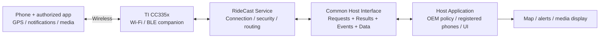
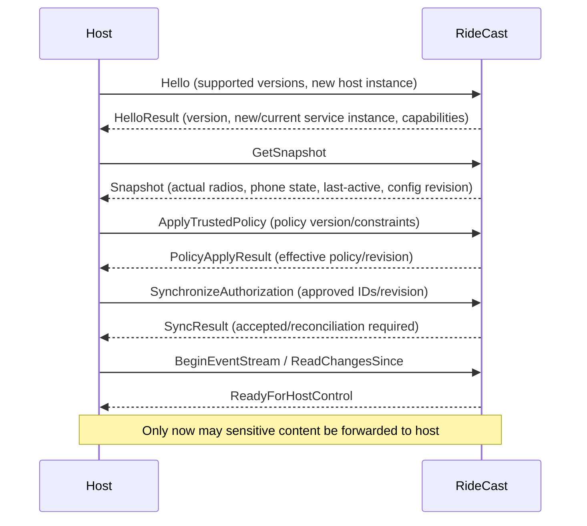
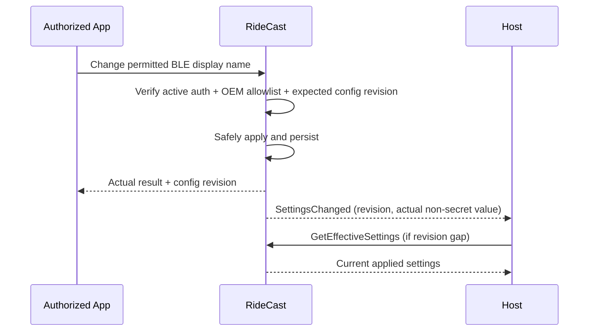

# 03 — RideCast Host Interface: Logical Contract and OEM Integration

> **Document type:** Host ↔ RideCast interface proposal and architecture handoff  
> **Version:** 0.1 — design draft for review  
> **Date:** 2026-11-05  
> **Status:** **PROPOSED, NOT FROZEN; NOT A BINARY PROTOCOL OR IMPLEMENTED API**  
> **Audience:** RideCast product/firmware team, vehicle OEMs, STM32/TI host developers, laptop-simulator developers, mobile-app team, test engineers, and future AI assistants  
> **Prerequisites:** [`01_RIDECAST_ARCHITECTURE_PLAN.md`](./01_RIDECAST_ARCHITECTURE_PLAN.md) and [`02_RIDECAST_PRODUCT_FLOWS.md`](./02_RIDECAST_PRODUCT_FLOWS.md)  
> **Next recommended document:** `04_RIDECAST_WIRE_PROTOCOL.md` (only after interface decisions are reviewed)

---

## 0. Read this first: the contract we are designing

**RideCast is a black-box wireless connectivity service, not the instrument-cluster UI.** It manages a supported TI CC335x companion radio through an application MCU, establishes protected phone connections, enforces phone identity and effective permissions, and forwards **authorized** location/navigation, notifications, and media metadata to a host. The host renders the map, notification popups, and music information.

The **Host** can be an STM32H7B3 cluster, a TI processor, or a laptop test application. The **RideCast Service** can run on the *same* processor as the Host (combined build, internal transport) or on a *separate* MCU (adapter PCB, UART initially; USB optional later). **Only the transport/porting code should need to change when deployment changes; the product meaning of the interface must remain unchanged.**

This document defines the **semantic Host Interface**: operations, results, events, identity, state synchronization, error outcomes, and behavior. It **does not freeze** command opcodes, bytes on the wire, a C ABI, BLE UUIDs, Wi-Fi mode, PIN implementation, pin assignments, a specific RTOS, or a CC335x driver. Previous RideCast packet formats and code are **not binding** for this fresh design. Do not resurrect the old protocol by default.

### Agreed decisions that this interface MUST preserve

| Decision | Requirement |
|---|---|
| Hybrid startup | Trusted OEM/host policy governs radio startup and known-phone auto-reconnection. |
| New phone | **Every new registration requires cluster approval and a fresh cluster-generated displayed code.** Unknown phones are not silently registered at power-on. |
| Returning phone | A registered phone may reconnect without a new code **only after cryptographic proof and current authorization**. |
| Multiple phones | Multiple registrations may be stored, but **exactly zero or one** phone is the active source of user content. |
| Selection | Auto-reconnect **the last successfully authenticated AND activated phone only**. No owner priority, no automatic fallback, no automatic preemption. |
| Switching | A different registered phone requires an **explicit authorized user action**. Only successful activation changes the saved last-active phone. |
| Phone settings | An authenticated phone app may **directly** change only allowlisted settings; no per-change host approval, but the host must learn the result and stay synchronized. |
| Idle | Radio/no-phone timeout and low-power action are **OEM-selectable** within the hardware and security constraints. |
| Ownership | Host controls vehicle-facing policy, enrollment approval and UI. RideCast owns radio security, live link truth, cryptographic phone identity, and wireless enforcement. |

**Precedence:** agreed product behavior in Document 02 overrides conflicting historical suggestions in Document 01. Open decisions remain open; a sample message name in this document is **not a final wire-level command**.

---

## 1. Participants, trust boundaries, and scope



**Host responsibilities**

- Present user controls and correct current state; decide when a rider may pair, switch, forget or change vehicle policy.
- **Generate** the fresh displayed enrollment code using a suitable cryptographic random source and authorize the candidate enrollment, under the agreed security method.
- Maintain the trusted approved-phone policy and its own host-side persistent view; provide policy on boot/re-synchronization.
- Control allowed radio/service state through the interface, within the OEM profile; treat reported **actual** state as authoritative for UI.
- Render maps, position markers, turn instructions, notifications and music widgets; RideCast does not draw maps or decode/display audio.

**RideCast responsibilities**

- Initialize/operate the radio, manage secured connections and phone-side credentials/bonding, and enforce the applied policy.
- Prove returning-device identity with cryptographic credentials, never with just a name or MAC address.
- Keep new devices non-active until the host has approved and enrollment has been safely committed.
- Preserve the last-successfully-active phone reference, maintain one active content source, report real connection state and faults.
- Validate/rate-limit/rout user content, and expose feature availability; never treat wireless link-up as user authorization.

**Phone app responsibilities**

- Ask for OS permissions and send only data the user has authorized.
- Complete the agreed secure onboarding and subsequent authentication.
- Request *allowlisted* settings changes using an authorized session; handle reconnect when credentials or SSID change.

**Out of scope for Document 03:** physical wiring, BLE pairing method selection, radio driver feasibility, full phone-app API, map tile format, audio streaming, byte-level framing, cryptographic protocol primitives, legal/automotive compliance certification.

### Deployment modes — same semantic contract

| Deployment | Host Interface transport | Important rule |
|---|---|---|
| STM32H7B3 + CC335x, combined | In-memory queues/callbacks/IPC | Do **not** skip authorization, version checks or state synchronization because modules share a process. |
| TI processor + CC335x, combined | In-process or OS IPC | Common request/result/event semantics; TI-specific driver/OS port. |
| Small RideCast MCU + CC335x → STM32/TI host | Framed UART initially | Host and RideCast maintain independent boot/fault lifecycles. |
| Small RideCast MCU + CC335x → laptop | UART via USB-to-UART, or future native USB | Same Host API; PC simulator is a conformance reference. |

*Hardware caution:* STM32G0 is **only a candidate** for a future small RideCast MCU. Its memory/flash/peripherals and CC335x host-driver feasibility must be validated. CC335x is a **companion radio**, not the application processor running RideCast.

---

## 2. Design rules for the common Host Interface

1. **Semantic stability:** the same operation means the same thing over internal IPC, UART and future USB.
2. **Request ≠ completion:** accepted requests may finish asynchronously; the host must wait for the operation outcome and/or a state update.
3. **Capabilities first:** the host discovers supported features, limits and schema versions; unsupported commands fail explicitly.
4. **Full re-sync:** after either side reboots or the link returns, the host queries a fresh authoritative snapshot rather than trusting old events.
5. **Explicit selection:** last-active-only auto-connect; never silently fall back to another stored phone.
6. **Single active stream owner:** data forwarded to host must be attributed to the currently authorized active phone/session.
7. **Precise status:** radio power, advertising, link, authentication, enrollment, active-phone selection and content availability are independent.
8. **Idempotent control:** retrying a timed-out request must not register a phone twice, perform multiple factory resets or apply a setting twice.
9. **Durable versus volatile:** registrations, policy and last-active selector are persistent; link handles, temporary codes and active sessions are not.
10. **No secrets in ordinary payloads/logs:** protect enrollment authorization, credentials and PII; redaction is mandatory.
11. **Bounded resources:** inputs, queues, sizes, rates and device counts have declared limits and defined backpressure.
12. **OEM-neutral integration:** no host-brand-specific conditionals in the RideCast service core; those belong in OEM policy or ports.

---

## 3. Interface model and naming (proposed)

The common API has four directions/types:

| Type | Direction | Meaning | Example |
|---|---|---|---|
| **Request** | Host → RideCast | Ask to perform an operation | `ConnectRegisteredPhone` |
| **Result** | RideCast → Host | Accepted/rejected/completed outcome for a particular request | `operation_id`, result code, actual state |
| **Event** | RideCast → Host | Unsolicited or delayed state transition | `PhoneActive`, `EnrollmentCandidate` |
| **Content data** | RideCast → Host | Authorized phone-derived application data | `LocationUpdate`, `NotificationReceived` |

Additionally, an authorized phone app communicates **with RideCast through its own protected phone-side interface**. The Host Interface does not require the phone to send host-control requests directly to the vehicle ECU. A permitted app setting change is an internal request to RideCast that generates Host **events** describing actual changes.

### Common conceptual envelope

Names below describe **fields in a semantic message**, not packed C fields or bytes on UART.

| Field | Required? | Purpose |
|---|---|---|
| `interface_version` | Yes | Version/compatibility of the logical contract. |
| `message_kind` | Yes | Request / result / event / data. |
| `message_name` | Yes | Semantic operation or event. Final numeric IDs TBD. |
| `request_id` | For requests/results | Correlates the result to the initiating operation; never rely on arrival order. |
| `service_instance_id` | For stateful messages | Changes when RideCast restarts; prevents accepting results from a previous boot. |
| `host_instance_id` | On host handshake | Changes when host service restarts; enables safe policy re-authorization. |
| `state_revision` | For snapshots/state changes | Monotonically increasing within the relevant service instance; order and gaps detectable. |
| `config_revision` | For settings | Persistent generation of applied configuration; supports conflict detection. |
| `phone_id` | Where applicable | Stable **opaque** authorized identifier; never a phone name, BLE MAC or key. |
| `operation_id` | Long operations | Tracks async enrollment/connect/update across start, progress and completion. |
| `result_code` | Results | Actual outcome from Section 8. |
| `timestamp/age` | For time-sensitive data | Origin time or age + validity indicators; clock/synchronization method TBD. |

For initial implementation, a strict serialized control plane and one in-flight mutation per affected resource (connection, enrollment, settings, registration) are easier to reason about than unconstrained parallel commands. Asynchronous events and high-rate location data remain separate from the control state machine.

### Example *logical* request/result (not wire JSON)

```json
{
  "kind": "request",
  "name": "ConnectRegisteredPhone",
  "request_id": "req-128",
  "phone_id": "opaque-phone-B",
  "origin": "HOST_USER_ACTION"
}
```

```json
{
  "kind": "result",
  "name": "ConnectRegisteredPhone",
  "request_id": "req-128",
  "status": "ACCEPTED",
  "operation_id": "op-43"
}
```

Later, a `PhoneActive` or `OperationCompleted` event establishes **actual successful activation**. `ACCEPTED` alone does not imply connected.

---

## 4. Host startup handshake and authoritative synchronization

### Proposed required sequence



**Critical rules:**

- RideCast may start an **already authorized last-phone reconnection** before host readiness **only if a trusted persisted OEM policy expressly permits it**. No new-device enrollment may auto-open simply because the board powered on.
- Pre-host-sync wireless connection is **not** permission to forward personal data to an unsynchronized host.
- The host uses actual `snapshot + revisions` to recover from missed events. When event history is unavailable or has a gap, re-request a snapshot.
- The host must not assume a UART/USB cable, transport open event or shared-process callback means a trusted host authority exists. Production split-mode authentication/provisioning must be specified later.
- A stale snapshot from a prior `service_instance_id` is invalid; old pending operations require status reconciliation or are treated as unknown.

### Proposed snapshot shape

- Contract version, capabilities, service instance, health/fault summary.
- Host-link/authentication state and applied policy revision.
- Separate BLE and Wi-Fi actual states (including discovery/association, where supported).
- Enrollment state (without revealing any PIN or secret).
- Registered-phone count/opaque IDs (with authorization state, subject to permissions).
- Current active phone ID (or none), `last_active_phone_id` (or none).
- Reconnection target and deadline/remaining time, if meaningful.
- Current persistent configuration revision and relevant non-secret effective values.
- Per-feature availability: location, navigation, notifications, media, possibly per-source freshness.
- Last reported recoverable fault and any required operator action.

**Snapshot-consistency requirement:** event-stream sequencing must prevent a gap between fetching the snapshot and subscribing to changes. Choose atomic subscription+snapshot or an event cursor/high-water mark during the wire-protocol design.

---

## 5. Proposed Host → RideCast request catalog

These are **semantic names to review**, not registered command opcodes. A supported target may reject an optional feature using `NOT_SUPPORTED`.

### 5.1 Service, discovery, policy and health

| Request | Intended behavior | Result and event obligation |
|---|---|---|
| `Hello` | Negotiate compatible interface/capabilities and instances. | Version/capability result; reject incompatible major version. |
| `GetCapabilities` | Report radio modes, feature support, constraints, maximums. | Actual capabilities; no invented supported features. |
| `GetSnapshot` | Return authoritative actual status and revisions. | Consistent snapshot; event-cursor semantics. |
| `GetHealth` | Read non-secret faults, recovery status, diagnostics. | Bounded diagnostics with redaction. |
| `ApplyTrustedPolicy` | Apply authenticated OEM/host policy within immutable security bounds. | Effective policy, accepted/rejected fields, revision; notify state changes. |
| `SetWirelessState` | Start/stop permitted BLE/Wi-Fi services independently. | Actual transition result; start does **not** imply discovery or phone authentication. |
| `RequestReconnectLast` | Attempt saved last successfully active phone **only**. | Progress and final connected/timed out/fault result; no fallback. |
| `CancelReconnect` | Stop a current reconnection attempt. | Cancellation acknowledged when effective. |
| `GetRegisteredPhones` | List authorized opaque IDs, safe labels and eligibility. | Paginated/bounded response, never bond/key material. |
| `GetEffectiveSettings` | Read approved non-secret effective values and revisions. | Redacted readback of credentials; secret values never echoed. |

`StartWireless` and `StartEnrollment` are deliberately **different operations**. BLE enabled and BLE discoverable for **new phones** must never be interchangeable.

### 5.2 Enrollment — always host-approved and code-controlled

| Request | Intended behavior | Key rule |
|---|---|---|
| `BeginEnrollment` | Host-authorized, time-bounded opportunity for an **unknown** phone to register. | Allowed only in safe/approved vehicle state. |
| `AuthorizeEnrollmentCandidate` | Bind the **host-generated** user-visible authorization step to one verified pending candidate. | Chosen proof method is TBD; cannot be a bare unauthenticated “PIN matched” flag. |
| `ApproveEnrollment` | Host approves the verified candidate's registration. | Temporary authorization only until durable commit. |
| `CommitEnrollment` | Finalize both sides' durable approved identity and radio-side credentials through a recoverable protocol. | No half-registered phone becomes active. |
| `CancelEnrollment` | Abort candidate/session; close time-limited public discoverability. | Revoke/delete temporary state. |
| `GetEnrollmentStatus` | Query any pending transaction after timeout/restart. | No secret code in response. |

**The cluster generates and displays the code.** RideCast may handle a cryptographic proof derived from it, but the precise BLE passkey/application challenge/OOB method and how the code/verifier crosses the trust boundary must be designed in a **security-specific document**. Do not send long-term keys or plaintext passwords on an unauthenticated Host Interface. A six-digit code alone must not be considered secure bonding.

### 5.3 Active phone selection and registration management

| Request | Intended behavior | Key rule |
|---|---|---|
| `ConnectRegisteredPhone(phone_id)` | **Explicit user-initiated** attempt to activate the selected registered phone. | Does not alter last-active until activation succeeds. |
| `DisconnectActivePhone` | Stop content, close/deactivate active phone as requested. | Does not delete bond or last-active selector. |
| `SwitchToRegisteredPhone(phone_id)` | End current active content session, attempt specific phone. | **No automatic rollback to prior phone** unless later explicitly agreed. |
| `SetLastActivePreference` | **Not exposed as arbitrary rename/priority control in v0.1.** | Last-active is an outcome of activation, not a freely writable preference. |
| `ForgetRegisteredPhone(phone_id)` | Revoke, disconnect if active, delete associated credentials and registration. | Clear last-active if it points at forgotten phone; no fallback. |
| `GetPhoneStatus(phone_id)` | Inspect one record's eligible/connected/active status. | Stable opaque identifier; redact secrets. |
| `FactoryReset` | Owner/service-authorized revocation of all credentials, approved records and personal settings. | High privilege, durable, fail-closed on partial failure. |

App-origin switching is an **open policy decision**. A direct app settings permission must not be mistaken for permission to switch to a different phone or add another phone.

### 5.4 Settings and controlled shutdown

| Request | Intended behavior | Key rule |
|---|---|---|
| `SetSettings` | Update validated OEM/host-allowed settings and apply safely. | Include expected revision; return effective values and revision. |
| `GetSettingsSchema` | Enumerate supported settings, types, limits, permissions and reboot/reconnect impact. | Helps OEM UI avoid unsupported controls. |
| `PrepareShutdown` | Stop new content and initiate controlled closing of radio links. | Result distinguishes initiated vs complete. |
| `EnterIdle` | Enter chosen radio idle/low-power mode. | Report *actual* mode and remaining host-command accessibility. |
| `CancelOperation` | Cancel cancellable in-flight operation by ID. | Not all operations reversible; indicate `TOO_LATE` when committed. |
| `GetOperationStatus` | Resolve a timed-out request with unknown outcome. | Never reissue destructive commands blindly. |

### 5.5 Data subscription and optional future control

| Request | Intended behavior |
|---|---|
| `SetContentSubscriptions` | Select authorized feature streams/rate budgets and backpressure limits. |
| `RequestContentRefresh` | Ask for fresh status/location/media, if phone integration permits. |
| `GetDiagnostics` | Bounded, privilege-gated non-secret operational metrics. |
| `StartUpdate` / `QueryUpdate` | **Future** secure firmware update contract; not part of minimal MVP. |

No RideCast API is required to render map tiles, select fonts, play local music, or update the instrument cluster display; those are **host responsibilities**.

---

## 6. RideCast → Host event and content catalog

Events and content are distinct from request results. All important state-changing events carry a service instance, state revision and applicable opaque IDs.

### 6.1 Lifecycle, radios and health

| Event | When emitted | Host action |
|---|---|---|
| `ServiceReady` / `ServiceRestarted` | Service boot/restart completed. | Re-handshake and re-sync. |
| `HostSyncRequired` | Identity, policy or event history must be reconciled. | Suspend stale assumptions; refresh snapshot. |
| `PolicyApplied` / `PolicyRejected` | Effective policy changed or failed. | Display actual policy/status. |
| `WirelessStateChanged` | BLE/Wi-Fi state actually transitioned. | Update radio indicators. |
| `ReconnectStarted` / `ReconnectExpired` | Same-phone retry started or timed out. | Avoid selecting fallback automatically. |
| `IdleEntered` / `ShutdownComplete` | Low-power or stop completed. | Update power status; coordinate physical supply. |
| `FaultRaised` / `FaultCleared` | Recoverable/fatal subsystem fault. | Show actionable fault and recovery state. |

### 6.2 Enrollment and registered phones

| Event | When emitted | Host action |
|---|---|---|
| `EnrollmentWindowOpened` | Authorized window actually available. | Show onboarding state. |
| `EnrollmentCandidateDetected` | Unknown phone requests enrollment. | Ask rider; cluster creates/displays fresh code. |
| `EnrollmentAuthorizationProgress` | Protected candidate proof in progress. | Update UI without leaking code. |
| `EnrollmentSucceeded` / `EnrollmentFailed` | Durable transaction finished or aborted. | Save/reconcile approved record and display outcome. |
| `EnrollmentClosed` | Completed, canceled or timed out. | Remove code from UI. |
| `RegisteredPhoneListChanged` | Record added, deleted or reconciled. | Refresh list. |
| `PhoneRevoked` | Phone credentials/authorization removed. | Delete stale UI/personal data. |

### 6.3 Connection and user-content state

| Event | When emitted | Host action |
|---|---|---|
| `PhoneLinkChanged` | Physical wireless link changes. | Do not label authenticated solely from this event. |
| `PhoneAuthenticated` | Cryptographic phone identity/session verified. | Evaluate current host authorization. |
| `PhoneActive` | **Single active content source** established. | Update UI; persist last-active only when RideCast confirms durable update. |
| `PhoneInactive` / `PhoneDisconnected` | Content session stops, or phone link is lost. | Mark content unavailable/stale. |
| `PhoneSwitchFailed` | Explicit switch did not activate target. | Explain; do not silently revert or pick fallback. |
| `FeatureAvailabilityChanged` | GPS/notifications/media availability changed. | Display real feature availability. |
| `SettingsChanged` | Host or **authorized app** changes applied settings. | Refresh UI using revision and effective values. |
| `ConfigurationRecoveryRequired` | Transaction interrupted, revisions disagree, or recovery needed. | Reconcile with authoritative config snapshot. |

### 6.4 Phone-origin data (not final schema)

| Data event | Minimum conceptual fields | Constraints |
|---|---|---|
| `LocationUpdate` | active `phone_id`, session ID, latitude/longitude, fix time/age, accuracy, source/validity | Host positions a marker; never assume stale GPS is live. No tiles/images carried by default. |
| `NavigationGuidance` | active phone/session, maneuver, distance, ETA, road/route summary, validity | Host renders arrows/map guidance; exact routing source and licensing depend on phone app. |
| `NotificationReceived` | active phone/session, safe app category, bounded title/body, importance/privacy flags, expiry | Only with user permissions; drop unauthorized/oversized data; don't log private text. |
| `MediaStatusChanged` | active phone/session, title, artist, play/pause/stop, progress/duration when available | **Metadata and playback status, not audio streaming.** |
| `FeatureUnavailable` | feature, reason, since/age | Host removes stale “live” indicators. |

**No auto-content from inactive registered phones.** Every accepted phone-content data item is bound to the current authenticated/authorized `active_session_id`. Drop or quarantine late packets from the former phone after a manual switch. Host may independently request reduced data rates or disable certain stream types.

---

## 7. Product journeys mapped into Host Interface exchanges

The following are **illustrative semantic sequences**. Their command names are proposals and do not imply a finalized packet layout.

### J1 — New scooter: first ignition and first pairing

```mermaid
sequenceDiagram
    actor U as Rider
    participant H as Host/Cluster
    participant R as RideCast
    participant P as Phone App
    H->>R: Hello / GetSnapshot / ApplyTrustedPolicy
    R-->>H: READY; no registered phone
    Note over R: No unapproved public pairing
    U->>H: Add Phone
    H->>R: BeginEnrollment
    R-->>H: EnrollmentWindowOpened
    P->>R: Request enrollment
    R-->>H: EnrollmentCandidateDetected(candidate_id)
    H->>H: Generate secure fresh displayed code
    H-->>U: Show code
    U->>P: Enter/confirm code
    Note over H,R: Secure proof bound to candidate and session (design TBD)
    R-->>H: Verified candidate evidence
    H->>R: ApproveEnrollment / CommitEnrollment
    R-->>H: EnrollmentSucceeded (durable approved phone ID)
    H->>R: ConnectRegisteredPhone (explicit selection)
    R-->>H: PhoneActive; last-active saved
    P->>R: GPS / notifications / media metadata
    R-->>H: Authorized content events
```

**Enrollment atomicity:** approval, credential/bond storage and host authorization records must be reconciled with a pending/committed state machine. On partial failure, the candidate remains **not active**, and incomplete records must be recoverable or revoked. This document does not choose the key exchange or commit protocol.

### J2 — Next ignition: last-active phone only

```mermaid
sequenceDiagram
    participant H as Host
    participant R as RideCast
    participant A as Phone A (registered)
    participant B as Phone B (last active)
    H->>R: Hello + trusted policy + approved IDs
    R-->>H: last_active = B
    H->>R: RequestReconnectLast (if not already starting by trusted policy)
    Note over A: A is nearby; not auto-selected
    B->>R: Authenticate using saved credentials
    R-->>H: PhoneAuthenticated(B)
    Note over H,R: Host authorization confirmed
    R-->>H: PhoneActive(B)
    R-->>H: B's permitted content only
```

**If B is absent:** emit `ReconnectExpired`; enter OEM-selected idle/retry mode. **Do not connect A automatically**. The last-active pointer remains B.

### J3 — Explicit user switch B → A

```mermaid
sequenceDiagram
    actor U as Rider
    participant H as Host
    participant R as RideCast
    U->>H: Switch to registered A
    H->>R: SwitchToRegisteredPhone(A)
    R-->>H: Accepted (operation ID)
    R->>R: Stop B content; disconnect/deactivate B
    R->>R: Attempt A only; cryptographic authentication
    alt A activates successfully
        R-->>H: PhoneActive(A), last-active=A
    else A fails or times out
        R-->>H: PhoneSwitchFailed(A)
        Note over R: Last-active stays B; no automatic fallback
    end
```

**Unresolved:** whether a failed switch may restore B *after a new explicit approval*; do not auto-revert by assumption. Whether a non-active phone app may initiate switching is also TBD.

### J4 — Authorized phone changes allowlisted settings directly



No per-change cluster approval is needed **for allowlisted operations**. Radio-impacting credential/SSID changes require a staged reconnect/recovery plan; sensitive non-allowlisted changes are denied.

### J5 — Idle, shutdown and restarts

- **No-phone timeout:** `ReconnectExpired` → effective OEM idle mode → `IdleEntered`; bonded phones and last-active preserved.
- **Ignition OFF:** host `PrepareShutdown` → RideCast closes sensitive forwarding/session → `ShutdownComplete` if time/power allows; persistent registrations survive.
- **RideCast restart:** new service instance ID → old operations/events invalid → handshake/snapshot/policy/auth sync → only then content resumes.
- **Host restart:** RideCast quarantines sensitive forwarding by default → new host instance + trusted policy/auth sync → resume approved data; no new enrollment automatically.
- **Sudden power loss:** previous fully committed settings/registrations recover. Partial enrollment/settings changes are not trusted.

---

## 8. Request results, failures, timing and correctness

### 8.1 Two-stage results

Every mutating request returns either:

- An immediate **`REJECTED`** with a reason (wrong state, no permission, unsupported, busy, invalid, security error), **or**
- An immediate **`ACCEPTED` / `IN_PROGRESS`** with an operation ID. Completion later reports **`SUCCEEDED`**, **`FAILED`**, **`CANCELED`** or **`EXPIRED`** and the **actual resultant state**.

A fast operation may complete in a single response, but clients must not rely on that optimization. **A request accepted into a queue is not proof of a radio transition, a new phone registration, or a persisted setting.**

### 8.2 Proposed result categories (symbolic; not numeric)

| Result | Meaning |
|---|---|
| `OK` / `SUCCEEDED` | The requested durable/actual postcondition is satisfied. |
| `ACCEPTED` / `IN_PROGRESS` | Work accepted; not yet complete. |
| `INVALID_ARGUMENT` | Malformed or out-of-bounds request. |
| `UNSUPPORTED` | Capability absent in this build/hardware. |
| `VERSION_INCOMPATIBLE` | Contract major version mismatch. |
| `NOT_AUTHORIZED` | Caller or phone lacks required permission. |
| `POLICY_DENIED` | Trusted OEM/vehicle-state policy blocks action. |
| `INVALID_STATE` | Operation not allowed in current lifecycle state. |
| `BUSY` / `CONFLICT` | Concurrent operation or config revision mismatch. |
| `NOT_FOUND` / `REVOKED` | Referenced phone not eligible/authorized. |
| `TIMEOUT` / `EXPIRED` | Operation deadline or pairing window elapsed. |
| `SECURITY_FAILURE` | Identity, proof, host trust, replay or permission failed. |
| `STORAGE_FAILURE` | Durable save/revoke did not complete safely. |
| `WIRELESS_FAILURE` | BLE/Wi-Fi driver or link operation failed. |
| `TRANSPORT_FAILURE` | Host–RideCast communication failed. |
| `OUTCOME_UNKNOWN` | Request timed out or host lost result; query operation/snapshot. |
| `TOO_LATE_TO_CANCEL` | Side effect already committed. |

### 8.3 Ordering, retries, idempotency

- Use `request_id` and `operation_id`; every request has a bounded expiry or queryable lifetime.
- Repeated **same request ID** with the same content should return the same recorded status where possible. Reusing an ID with different content is a conflict.
- Do not repeat factory reset, registration commit or credential changes blindly after communication loss. Call `GetOperationStatus` and `GetSnapshot` to reconcile the outcome.
- Serialize modifications to the active-phone state; reject or queue conflicting switch/enroll/disconnect operations explicitly.
- Make shutdown and revocation higher priority than cosmetic name changes and data streaming.
- Old events from prior instances must be discarded; gap/revision mismatch triggers snapshot recovery.
- Use explicit bounded deadlines and timeouts per operation type in the later protocol specification. Do **not** hardcode 60/120/180 seconds as final OEM requirements.

### 8.4 Backpressure, data quality, and stale detection

- Separate reliable low-rate control/events from potentially bursty user-content data.
- Define maximum supported message sizes, per-source rates, queue limits, and drop/report rules in Document 04.
- Prioritize lifecycle/authorization, revocation and faults over noncritical media/location refreshes.
- Latest-value-wins/coalescing may be suitable for **location/status** under overload; avoid silently dropping required authorization/result events.
- Host should detect stale GPS from source age/validity and stop depicting an old point as live.
- Notification text requires bounds, privacy flags and explicit user permission; do not log it as debug text.

---

## 9. Configuration authority and persistent state

### 9.1 Three configuration levels

1. **Build capability profile:** supported radio/driver features, resource limits, security minimums (OEM/vendor firmware build).
2. **Trusted OEM/host policy:** startup mode, idle timeouts, app-editable allowlist, vehicle-motion restrictions, reconnection permissions, max allowed registrations.
3. **Authorized app/user settings:** permitted device display names and preferences within the effective policy.

**Precedence:** immutable security constraints → authenticated OEM policy → host-controlled decisions → allowlisted user/app changes. A permitted app setting does not give permission to add a phone or bypass host enrollment approval.

### 9.2 Suggested owner-of-record matrix

| State | Persistent owner(s) / source of truth | Reconciliation rule |
|---|---|---|
| Radio credentials / BLE bonds | RideCast secure storage | Do not export secrets to host; revoke on approved forget/reset. |
| OEM policy | Provisioned trusted authority and RideCast's verified effective copy | Host sends authenticated revision; deny weaker security. |
| Approved phone identity/permissions | Host approved registry **and** RideCast authorized mapping | Both must agree before content activation; pending ≠ active. |
| Last-successfully-active phone | RideCast's durable selector, visible to host | Change only on fully authorized active session; host reconciles from actual state. |
| Device labels / Wi-Fi SSID / allowed user settings | RideCast effective settings + persisted revision; host caches | App/host writes with expected revision, apply/reconcile actual values. |
| Enrollment PIN / candidate challenge | Ephemeral host-generated authorization context | Never durable or logged; expires and binds to one candidate/session. |
| Current active session | RideCast runtime (not durable) | Reset/reboot requires fresh authentication/authorization. |
| Location / notification / media content | Ephemeral authorized phone session → host rendering | Never use stored/old records to imply current availability. |

The persistence mechanism must survive ordinary power-off, resist torn writes, and prevent a revoked device from regaining access if only one side rebooted. If approved-registration records disagree, **fail closed** and reconcile using an authorized recovery flow.

### 9.3 Concurrent host/app setting writes

**Proposed initial rule:** `SetSettings` includes an `expected_config_revision`. If the device has a newer effective revision, reject with `CONFLICT` and return the current revision/nonsecret values. The caller reloads and explicitly resubmits if appropriate. This is preferable to silent last-writer-wins. The host receives `SettingsChanged` events for app-origin writes. The exact storage transaction and rollback semantics for live Wi-Fi credential changes remain to be designed.

---

## 10. Security, privacy and safety requirements for the interface

**Before production, a threat-model/security review must determine the following:**

- **Trust in the Host Interface:** separate UART/USB link might be physically accessible or spoofable; production commands require a defined authenticated endpoint and integrity/replay protection, not merely CRC. Combined-mode access control still matters.
- **BLE onboarding:** the host generates and displays the fresh code, but the BLE Secure Connections pairing method (passkey, numeric comparison, OOB or app authorization on an already secured channel) is *not decided*. Avoid falsely equating a six-digit app PIN with encrypted, MITM-resistant pairing.
- **Returning phone:** validate cryptographic identity and fresh session; no trust by BLE address, Wi-Fi SSID, device nickname, or phone-reported ID alone.
- **App permissions:** direct write only for policy-allowlisted settings and a verified active authorized app session. Changes that impact other owners, factory reset or security minimums require more authority.
- **Enroll/forget transaction:** both Host and RideCast durable state must agree before activation. On torn commits or revocation mismatch, block the device pending recovery.
- **Vehicle safety:** no unrestricted pairing/password-entry controls while vehicle state forbids them; do not assume user is parked unless state is trusted.
- **Secrets and privacy:** no PINs, Wi-Fi passwords, bond keys, message bodies, full GPS history or secret verifiers in ordinary logs, metrics or diagnostic snapshots.
- **Transport independence:** internal IPC does not remove authentication/authorization semantics; physical transport changes must not weaken feature behavior.
- **Device lifecycle:** controlled factory reset, credential revocation, key provisioning and signed firmware updates require later product/security specifications.

**Fail-safe default when trust is unavailable:** do not open first-time enrollment, do not accept unauthorized config changes, do not forward personal data to an unsynchronized/untrusted host, and do not connect a different known phone as fallback.

---

## 11. Explicitly unresolved decisions — DO NOT invent defaults

| ID | Decision needing approval | Why it matters |
|---|---|---|
| U01 | Who may initiate a manual switch: host UI only, or approved phone app too? | Avoid unauthorized switch from inactive phone. |
| U02 | After a failed B → A switch, remain disconnected or restore B **only after new user approval**? | Avoid unwanted preemption/reconnect. |
| U03 | Exact BLE passkey/application-challenge mechanism for a cluster-generated PIN; host link protection | Determines safe enrollment proof. |
| U04 | Registered phone limit and what happens when limit is reached | Storage/UI/eligibility. |
| U05 | Wi-Fi vs BLE policy, concurrency, activation path and supported CC335x variant | Radio/driver feasibility. |
| U06 | OEM startup/idle/reconnect timeouts and defaults | Power budget and rider experience. |
| U07 | How long a phone link may be maintained while host is rebooting/unavailable | Safety, privacy, reconnection latency. |
| U08 | Authorized settings allowlist and privileged Wi-Fi password-change policy | Permissions and rollback. |
| U09 | Exact host/app settings revision-conflict semantics (CAS proposed) | Deterministic synchronization. |
| U10 | New enrollment while another phone is active: parallel or disconnect first? | Radio capability and single-active guarantee. |
| U11 | Host/adapter identity provisioning and production host-link protection | OEM-grade trust model. |
| U12 | Android-first versus iOS scope, phone data source/permission constraints | Feasibility of actual data. |
| U13 | Exact schema limits for location, navigation, notification, media, timestamps/clock sync | Interoperability and stale detection. |
| U14 | Signed updates, OEM commissioning, service diagnostics, rollback and ownership transfer | Product security/lifecycle. |

**Working proposal, not settled:** use optimistic revision checks for configuration; on a failed explicit phone switch do **not** auto-fallback or silently reconnect B. These should be reviewed before freezing interface v1.

---

## 12. Suggested minimum viable Host Interface (Milestone M0)

Before actual TI CC335x driver bring-up, implement the contract over a **simulated RideCast service** and compare internal IPC versus UART behavior. M0 should include:

1. `Hello`, `GetCapabilities`, `GetSnapshot`, host-policy synchronization and explicit version mismatch handling.
2. Separate BLE/Wi-Fi readiness and actual-state reporting, using simulated radio status.
3. `BeginEnrollment`, candidate event, cluster-generated code callback, approved/denied/canceled outcome, no half-registered activation (simulated secure proof initially; **never claim production security**).
4. Multiple stored mock phone registrations; exact **last-active-only** reconnect, no fallback; authenticated/active separation.
5. Explicit manual switch; single active session; last-active update only after success; failure case preserved.
6. One app-allowlisted settings update, `SettingsChanged` event to host and revision conflict handling.
7. `LocationUpdate`, `NotificationReceived` and `MediaStatusChanged` from **only** the active simulated phone.
8. No-phone timeout → configurable idle event; host and RideCast restart recovery and snapshot reconciliation.
9. Negative tests for unauthorized registration, malformed request, duplicate ID, stale instance, lost events and unavailable last phone.
10. Exactly the same test vectors against **combined-mode in-process transport** and **split-mode UART/PC simulator**.

A prototype can pass semantic tests before physical radio integration, but it must be labeled **SIMULATED**, not hardware/security validated.

### Suggested next code-level boundaries (names illustrative)

```text
common/host_contract/        # Request/result/event definitions, no Zephyr types
common/validation/           # Bounds, version, permission checks
service/manager/             # Serialized RideCast state machine
service/registration/        # Pending/enrolled/revoked and last-active logic
service/settings/            # Revisions and effective policy
service/content/             # Active-session content routing
host/client/                 # Host-side typed API and subscriptions
transports/inprocess/        # Combined-mode bridge
transports/uart/             # Split framed transport adapter
ports/stm32h7_zephyr/        # MCU + RTOS bindings
ports/ti_*/                  # Future TI board/OS port
simulators/pc_host/          # OEM reference/test host
```

Keep the logical Host Interface independent of the implementation transport; **only the transports/ports should know about Zephyr message queues, UART drivers or OS IPC**.

---

## 13. Acceptance tests (draft Host Interface conformance gates)

| ID | Required test outcome | Product flow reference |
|---|---|---|
| H01 | Boot handshake detects supported/incompatible interface versions. | S01/S14/S15 |
| H02 | No unknown phone enrolls without approved cluster enrollment. | S01/S03/S16 |
| H03 | Fresh cluster-generated code binds to correct candidate and expires; failure leaves no active registration. | S03/S16 |
| H04 | Last-active phone B reconnects securely; no new PIN on valid return. | S02/S04 |
| H05 | B unavailable, known A available → **no automatic fallback**. | S05/S06 |
| H06 | Switch B→A succeeds → only A active, durable last-active=A. | S07 |
| H07 | Switch B→A fails → last-active remains B; no silently selected phone. | S07 |
| H08 | App changes an allowlisted name directly → host receives current settings revision. | S09 |
| H09 | App attempts forbidden security/registration change → denied and audited without secret leakage. | S09/S16 |
| H10 | Host/app concurrent setting modifications report deterministic conflict. | S09/S10 |
| H11 | Timeout results in configured radio idle mode without clearing bonds. | S11 |
| H12 | Ignition shutdown preserves valid registrations/last-active. | S12/S13 |
| H13 | After RideCast reboot, old session/operation IDs invalid; snapshot sync required. | S15 |
| H14 | After Host reboot, personal content waits until trusted resynchronization. | S14 |
| H15 | Forget last-active phone clears selection and revokes bond; no fallback. | S18 |
| H16 | Data from inactive or revoked phone is blocked, even if a stale packet arrives late. | S05/S18/S20 |
| H17 | Fault and queue/transport loss cannot be mistaken for success. | S19 |
| H18 | Same semantic test vectors pass via in-process and UART transport. | Combined/split architecture |
| H19 | GPS freshness, missing permissions and media availability are represented accurately. | S17 |
| H20 | Credential/PIN/notification content is not emitted through ordinary logs/snapshots. | Security and privacy |
| H21 | Conflicting operations are serialized; retrying a request ID has defined behavior. | S07/S09/S20 |
| H22 | Factory reset does not leave usable orphaned phone authorization. | S18/S22 |

**Gate definitions:** `SPEC REVIEWED` ≠ `SIMULATOR PASS` ≠ `HARDWARE PASS` ≠ `SECURITY REVIEWED` ≠ `OEM RELEASE APPROVED`. Record these independently.

---

## 14. What the OEM receives (future Host Integration Guide)

Once finalized, RideCast should provide the following to Bajaj/TVS/other OEM integrators:

- One versioned Host Interface specification and a supported-feature/capability list.
- Typed host-side library or SDK wrapping requests, results and event dispatch.
- Physical transport guide for UART/USB (when relevant); internal-port guide for combined builds.
- State diagrams and example sequences: boot, add phone, reconnect, switch, idle, name change, forget, shutdown.
- Registration and permissions model, trust assumptions, safe reset/recovery procedure.
- Clear limits and latencies: phone count, message sizes, concurrency, timeouts, supported phones/OS versions.
- Reference laptop host simulator and automated compatibility/conformance tests.
- Security provisioning and firmware update process, after productization design is complete.

**The OEM should be able to treat RideCast as a black box:** initialize, query capability, apply trusted policy, receive verified states/content, handle user approval and display, and recover explicitly from faults—without depending on the TI CC335x driver details.

---

## 15. Document-to-document handoff and revision rules

| Document | Primary purpose | Current authority |
|---|---|---|
| `01_RIDECAST_ARCHITECTURE_PLAN.md` | Product identity, deployment flexibility, code portability | Architectural background; historic implementation examples not binding |
| `02_RIDECAST_PRODUCT_FLOWS.md` | **Agreed** OEM-facing behavior and use cases | **Source of truth for user-visible policy** |
| **`03_RIDECAST_HOST_INTERFACE.md`** | **Proposed** Host ↔ RideCast semantics and operation catalog | Discussion draft; not yet locked as an API or protocol |
| `04_RIDECAST_WIRE_PROTOCOL.md` | Future exact framing, opcodes, encoding, bounds, transport ACKs, test vectors | **Not yet created / not decided** |

When design changes are agreed, update Document 02 first if the change affects product behavior. Update Document 03 to match; only after semantic approval freeze wire types in Document 04. Avoid silently changing the protocol contract as a side effect of implementing a board driver.

### Future-conversation instructions (read this if this file is shared alone)

1. We are designing **RideCast** as an OEM-facing, portable, black-box connectivity adapter/service built around an MCU + supported Wi-Fi/BLE companion radio, presently considering TI CC335x.
2. It may run **combined** with the host on STM32H7B3/TI hardware, or **separate** on an adapter MCU connected to STM32, TI or laptop through UART/USB. Host and RideCast remain logically distinct.
3. The host generates and displays new-enrollment authorization codes and approves each new phone. Secure radio proof and durable registration must also succeed. Existing eligible phones reconnect without re-enrolling.
4. Multiple phones may be registered, but **only the last successfully active phone is automatically attempted**. **Never auto-fallback** to another registered phone. One active content source at a time.
5. A direct setting change by an authorized app is permitted **only if OEM allowlisted**, with a real effective result and settings-changed notification to the host.
6. The host renders maps, notifications and media. RideCast forwards validated authorized data; ordinary music features refer to **metadata**, not streamed audio.
7. Separate **request accepted** from **operation completed**; expose snapshots, capabilities, opaque phone IDs, state revisions and exact error outcomes; make restarts/recovery explicit.
8. Do **not** treat the symbolic names/tables in this document as assigned opcode bytes or proven implemented code. Earlier ESP32 RideCast protocol implementations are historical and explicitly out of scope as constraints for this new interface.
9. Do not invent answers to the open questions in Section 11. Review them with the product owner, then mark each resolved item and add tests before freezing version 1.
10. Next sensible activity: review interface priorities and enrollment security + manual switching rules, then write a precise but transport-neutral typed data model, and only then a concrete wire format.

### One-sentence Host Interface contract

> **Across combined and separate deployments, the host must be able to control policy and phone registration, observe actual RideCast wireless/authentication state, select only explicitly authorized phones, and receive validated content from exactly one active source through the same versioned logical interface.**
