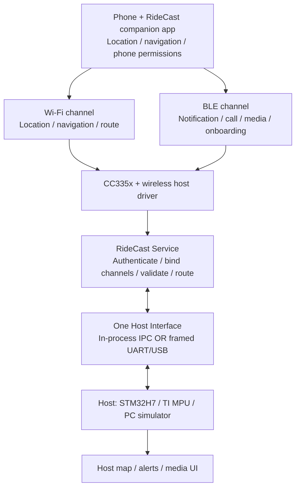
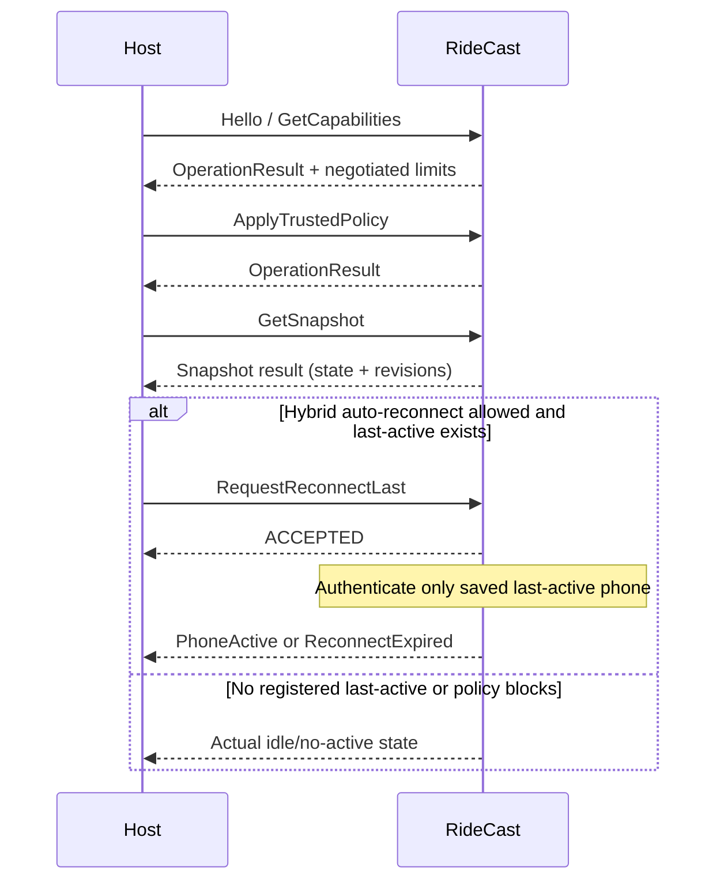
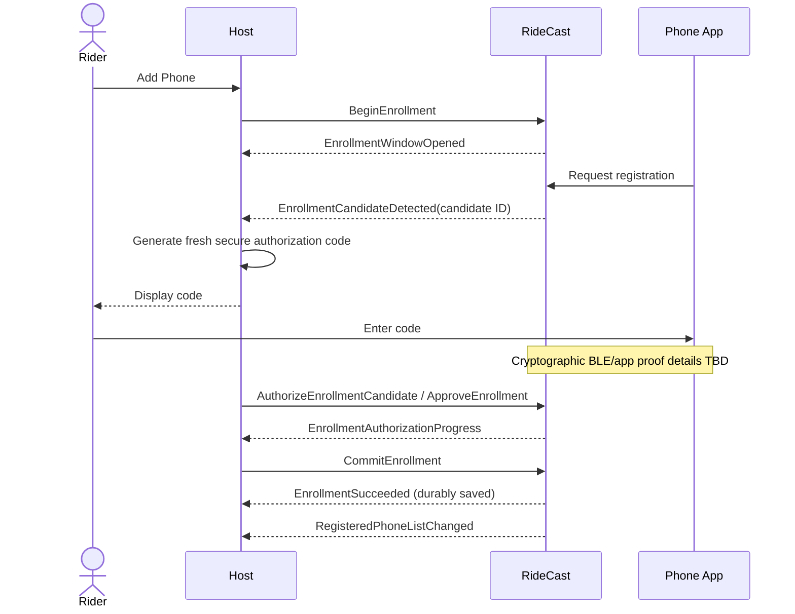
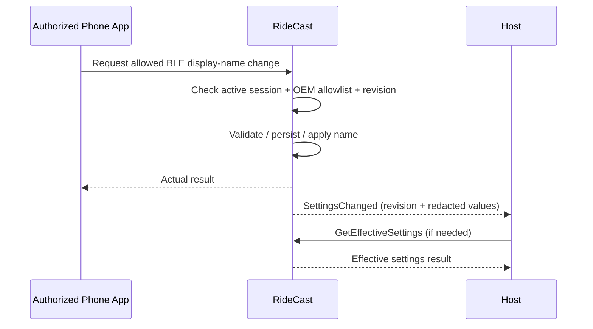
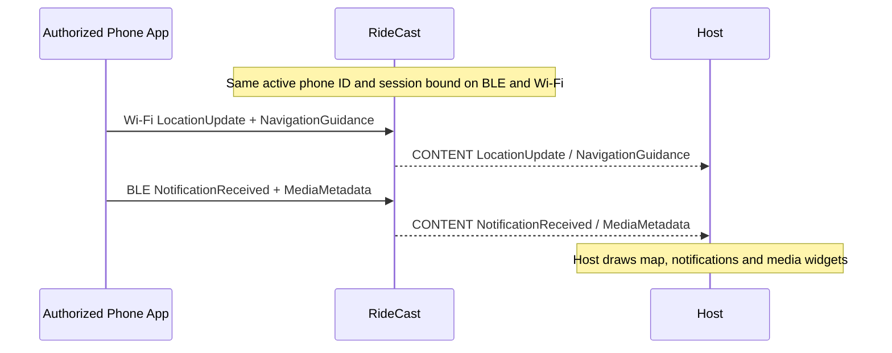

# 04 — RideCast Wire Protocol & Dual-Wireless Routing Contract

> **Document type:** Proposed Host ↔ RideCast wire protocol, transport behavior, and phone-channel routing boundaries  
> **Version:** 0.1 — **DESIGN DRAFT / NOT FROZEN**  
> **Date:** 2026-11-05  
> **Status:** For architecture/security/OEM review; **not a tested firmware implementation**  
> **Read with:** [`01_RIDECAST_ARCHITECTURE_PLAN.md`](./01_RIDECAST_ARCHITECTURE_PLAN.md), [`02_RIDECAST_PRODUCT_FLOWS.md`](./02_RIDECAST_PRODUCT_FLOWS.md), [`03_RIDECAST_HOST_INTERFACE.md`](./03_RIDECAST_HOST_INTERFACE.md)  
> **Scope:** One logical interface used between RideCast and the host over in-process IPC, UART, or a future USB transport; plus routing rules for the separate phone-side Wi-Fi and BLE channels.

---

## 0. Executive summary — read this first

**RideCast is a wireless adapter/service; the Host draws the map and UI.** The phone supplies authorized navigation/location data and phone notifications/media status. RideCast establishes secured wireless communication and passes validated, authorized content to the Host. The Host may be an STM32H7B3, a TI processor, or a laptop. RideCast may share the Host's processor (**combined deployment**) or run on its own MCU with CC335x (**split adapter**).

**Agreed behavioral requirements carried from Documents 01–03:**

1. **Hybrid power-on:** OEM/Host policy decides which wireless services automatically start; known-phone reconnection is allowed when policy permits. Starting a radio is **not** equivalent to opening enrollment.
2. **New phone:** Every first-time registration needs **Host/cluster approval and a fresh code generated and displayed by the Host**. The concrete BLE security and code-verification mechanism remains to be designed.
3. **Returning phone:** Reconnect using cryptographic credentials without a new PIN; trust neither device name nor MAC address alone.
4. **Last-connected phone only:** On automatic reconnection, attempt **only the last successfully authenticated and activated phone**. No owner priority, no automatic fallback, no automatic preemption. A different device requires explicit authorized selection/switch.
5. **Multiple stored registrations, one active content source.** The active phone is the only device allowed to feed vehicle-facing location, notifications, and media content.
6. **Direct authorized app settings:** An authenticated app can change only settings allowed by effective OEM/Host policy, without fresh Host approval for each allowed change. The Host receives actual settings-change events and revisions.
7. **Idle:** OEM selects no-phone/reconnect/radio-idle policy within safety/security constraints.
8. **Transport portability:** The product meanings of requests/results/events remain identical in combined and split deployments.

**Newly agreed preferred wireless channel allocation (this document's main update):**

| Phone → RideCast channel | Primary data | Why |
|---|---|---|
| **Wi-Fi** | Continuous GPS/location, navigation instructions, route geometry, optional future larger map-related data | More throughput when larger/burstier navigation data is needed; location samples themselves are small |
| **BLE** | Authorized phone/app notifications, chat alerts, incoming call status, music title/artist/play state, onboarding/control | Suitable for lower-rate status and event messages |

This is the **preferred first-version routing policy**, **not** a claim that a phone OS exposes all data over BLE by itself. A companion application and appropriate phone permissions/integration are required. **Map tiles are not transferred through RideCast by default; the Host obtains/caches licensed tiles separately and renders them. Music metadata is not audio streaming.**

> **Security invariant:** If BLE and Wi-Fi are both active, their data must be bound to the **same authenticated, Host-authorized active phone**. Never merge navigation from Phone A with notifications from Phone B.

**What is only a proposal in Document 04:** Message numbers, frame layout, byte order, checksum, payload size, payload encoding, status codes, retries, exact quotas, and timers below. They are a coherent starting point to test and review, **not an approved or backwards-compatible protocol**. Older ESP32 RideCast packet IDs/layouts are **not binding** for this new contract.

---

## 1. Terminology and system boundaries

| Term | Meaning |
|---|---|
| **Host** | Cluster/display controller or laptop simulator. Owns OEM policy, pairing consent/code presentation, UI, maps, and vehicle-facing decisions. |
| **RideCast Service** | MCU/RTOS-independent logical wireless gateway: connection management, cryptographic identity checks, permissions, phone data validation/routing, status. |
| **CC335x** | TI wireless companion radio (specific Wi-Fi/BLE capability depends on chosen part). It needs a host MCU/processor and supported driver/firmware. |
| **Host Interface** | Logical commands/results/events/data specified in Document 03; **Document 04 proposes their serialization**. |
| **Host link** | In-process queue/callback, UART, or USB carrying Host Interface messages. **Distinct from phone-side BLE and Wi-Fi.** |
| **Active phone** | At most one registered, authenticated phone approved to supply the vehicle's user content. |
| **Registered phone** | An authorized identity with persistent cryptographic binding/bond material where applicable. Registered does **not** mean currently connected. |
| **Operation** | A requested action with an outcome that may finish asynchronously (e.g. Start Wireless, Enroll, Switch). |
| **Session** | Ephemeral authorized active-phone epoch. Invalid after disconnect, reboot, revocation or explicit switch. |
| **OEM policy** | Trusted vehicle/manufacturer configuration that limits runtime behavior and app settings. |

### 1.1 Logical diagram



**Combined deployment:** The Host App and RideCast Service run on the same processor. Use an in-process link implementation while preserving identical message structures and lifecycle checks. **Split deployment:** A dedicated MCU + CC335x runs RideCast and sends identical logical messages over framed UART or USB to another Host. An STM32G0 is only an *unvalidated candidate* MCU; confirm RAM, flash, bus, radio driver, and power budget before selecting it.

### 1.2 Two protocols, not one accidental dependency

1. **Phone ↔ RideCast wireless application protocol:** authentication, BLE GATT/service behavior, Wi-Fi connection/transport, Wi-Fi/BLE channel binding and phone-origin messages. The precise BLE UUIDs, GATT characteristics, socket protocol, radio roles, and handshake are **not locked here**.
2. **RideCast ↔ Host Interface wire protocol:** control, results, status, and forwarded validated content. This document proposes its framing and encoding. **The Host must not need to parse BLE packets or Wi-Fi driver-specific frames.**

The Host interface can report that content originated from BLE/Wi-Fi for diagnostics, but it should not expose raw security keys, phone tokens or radio-specific pointers.

---

## 2. Design principles and non-negotiable requirements

- One **semantic** Host Interface shared by Zephyr, another MCU RTOS, Linux, and Windows simulator.
- No raw `struct` memory copies on the wire; explicit widths, lengths, byte order and validation.
- Request acknowledgment and operation **completion are different**; not every accepted command succeeds.
- Link, authentication, active-phone, BLE and Wi-Fi availability states are independent.
- Complete resynchronization after either side boots/restarts; never trust old session flags.
- No content forwarding before active-session authorization and channel binding.
- Control, revocation, safe shutdown and fault messages outrank streaming location data.
- Bounded queues, sizes, retries, timeouts, duplicate handling and stale-location detection.
- Secrets, enrollment codes, passwords and private notification/location bodies must not appear in normal logs.
- CRC detects transmission errors **only**. It is not host authentication, confidentiality, anti-replay or BLE pairing security.
- No automatic reconnection to any phone other than the saved last successfully active identity.
- OEM-imposed capability/permission limits cannot be relaxed through an ordinary phone setting.

---

## 3. Proposed Host Interface message model

These message *kinds* are shared across every host-link transport.

| Kind | Numeric proposal | Direction | Description |
|---|---:|---|---|
| `REQUEST` | `1` | Host → RideCast | Host requests an operation or read. |
| `RESULT` | `2` | RideCast → Host | Correlated accepted/rejected/progress/complete result. |
| `EVENT` | `3` | RideCast → Host | Asynchronous lifecycle, state, health or config change. |
| `CONTENT` | `4` | RideCast → Host | Authenticated active-phone content for Host rendering. |

- Each Host request gets a nonzero `request_id` unique within that Host boot instance.
- Each accepted long-running operation gets a RideCast-issued `operation_id` in the result payload.
- Every event has a RideCast `boot_id`, a monotonic per-boot `sequence`, and relevant state/config revision(s).
- Every content item has an `active_session_id`, a logical `phone_id` (opaque), and origin/validity metadata.
- `GetSnapshot` is mandatory for recovery after reset, missed event, or broken link.
- The Host and RideCast must explicitly negotiate capabilities and **major version compatibility** before normal operations.

### 3.1 Control/result semantics

An immediate `RESULT` may say `ACCEPTED` or `REJECTED`; later a correlated result or completion event records actual success/failure. The Host should reflect observed actual state, not just an accepted request.

**Idempotency:** Retry the same `request_id` with the *same* payload only while the peer's boot instance and deduplication window are known. Reusing it with different content is `CONFLICT`. After uncertainty around a destructive action, use `GetOperationStatus` / `GetSnapshot`; never blindly repeat `FactoryReset`, `CommitEnrollment`, or a credential change.

### 3.2 Version and capability negotiation

1. On Host link readiness, Host sends `Hello` with its supported major/minor ranges and Host boot identity.
2. RideCast replies with its protocol version, service boot identity, supported features and size limits.
3. Host sends trusted policy as applicable and obtains a full snapshot before advertising any phone as active to the vehicle UI.
4. If major versions are incompatible: only minimal diagnostics/recovery operations are permitted. Normal enrollment/content forwarding fails closed.
5. Optional features must be detected through capabilities rather than inferred from a product name.

---

## 4. Proposed binary frame — **candidate, not frozen**

### 4.1 Canonical frame layout

All multibyte integer fields use **little-endian** in this proposed new v1 design. Historical RideCast prototype framing used a different format; do **not** treat the two as interoperable.

| Offset | Size | Field | Meaning |
|---:|---:|---|---|
| 0 | 2 | `magic` | ASCII `RC` (`0x52 0x43`). |
| 2 | 1 | `major` | Proposed `1`. |
| 3 | 1 | `minor` | Proposed `0`. |
| 4 | 1 | `kind` | `REQUEST=1`, `RESULT=2`, `EVENT=3`, `CONTENT=4`. |
| 5 | 1 | `flags` | `bit0=CRITICAL`; all other bits reserved as zero. |
| 6 | 2 | `message_id` | Proposed catalog ID from §6. |
| 8 | 4 | `request_id` | Correlation ID for request/result; `0` for unsolicited event/content. |
| 12 | 4 | `sequence` | Per-sender boot-instance counter; wrap behavior TBD before production. |
| 16 | 4 | `boot_id` | Sender's ephemeral nonzero boot-instance identifier; not a security identity. |
| 20 | 4 | `session_id` | Current active phone session; `0` when not applicable. |
| 24 | 2 | `payload_len` | Bytes of encoded payload only. |
| 26 | 2 | `reserved` | Must transmit zero; reject unsupported nonzero values. |
| 28 | N | `payload` | Typed fields from §5. |
| 28+N | 4 | `crc32c` | CRC-32C over header and payload (`0..27+N`), little-endian on wire. |

**Fixed header:** 28 bytes. **Unencoded frame length:** `32 + payload_len` bytes. **Proposed maximum payload:** **512 bytes** for the initial transport profile, giving **544 bytes** maximum before UART framing. This size is **a test target, not a guaranteed STM32G0 capability or a product limit**. `Hello` negotiates actual maximums, and implementations may reject larger or unsupported content explicitly.

**CRC-32C parameters (proposal):** Castagnoli polynomial, reflected `0x82F63B78`, initialization `0xFFFFFFFF`, final XOR `0xFFFFFFFF`. Standard test input `123456789` must produce `0xE3069283`. CRC must be verified before parsing payload fields.

**Limits and parsing:** Check framing, version, allowed flags, `payload_len`, expected total length, CRC and message-kind/direction validity *before* allocating or dispatching content. Use fixed/bounded buffers; never trust an unbounded advertised length.

### 4.2 Example structural frame (not production bytes)

```text
RC | version 1.0 | REQUEST | SetWirelessState | req=101
   | seq=8 | boot=host_boot_1 | session=0
   | payload={BLE: ON, Wi-Fi: OFF} | CRC32C

RC | version 1.0 | RESULT | OperationResult | req=101
   | seq=41 | boot=ridecast_boot_1 | session=0
   | payload={status: ACCEPTED, operation_id: 7} | CRC32C

RC | version 1.0 | EVENT | WirelessStateChanged | req=0
   | seq=42 | boot=ridecast_boot_1 | session=0
   | payload={BLE: ON, Wi-Fi: OFF, state_revision: 3} | CRC32C
```

The above is human-readable notation, **not JSON on UART**.

### 4.3 UART/USB transport envelope

**Proposed UART transport:** Encode each complete canonical frame using **COBS** and terminate it with byte `0x00`. The receiver collects bytes through the delimiter, decodes COBS, checks size, then verifies the canonical frame and CRC32C. An overlong or malformed frame is discarded to the next delimiter; the receiver must recover synchronization without rebooting.

```text
Host request bytes → canonical frame → COBS → 0x00 → UART
UART → collect to 0x00 → COBS decode → canonical frame → validate → dispatch
```

**Combined/in-process transport:** Pass exactly the **same logical schema** through an internal bounded message queue. The optimized version may avoid COBS/CRC copying internally if it is verified against the canonical codec; otherwise using canonical frames internally is the safer first reference implementation.

**Future USB:** USB CDC ACM can initially reuse COBS delimiter framing; alternate USB packetization requires an explicit negotiated transport adapter, not a separate application protocol. Do not assume CDC ACM is inherently authenticated.

**UART physical settings** (baud, voltage, flow control, connector, cable, DMA) are board/OEM-specific and **not** fixed by this wire contract. UART logging/CLI must never corrupt the Host Interface data stream.

---

## 5. Proposed payload encoding and validation

### 5.1 A small typed TLV codec

This v0.1 proposal uses **typed TLV** inside the payload. Every field is:

```text
[field_id:u16 LE] [type:u8] [byte_length:u16 LE] [value:byte_length bytes]
```

| Type code | Value | Encoding |
|---:|---|---|
| `1` | `U8` | Exactly 1 byte. |
| `2` | `U16` | Exactly 2 bytes, little-endian. |
| `3` | `U32` | Exactly 4 bytes, little-endian. |
| `4` | `U64` | Exactly 8 bytes, little-endian. |
| `5` | `I32` | Exactly 4 bytes, two's complement, little-endian. |
| `6` | `BOOL` | Exactly 1 byte: `0` or `1`. |
| `7` | `UTF8` | Length-prefixed UTF-8; no terminating NUL. |
| `8` | `BYTES` | Opaque bounded byte string. |
| `9` | `TLV_GROUP` | Nested TLVs, with defined maximum depth (proposed 2). |

- Each message defines required fields, optional fields, allowed lengths, value ranges, and rejection behavior.
- Unknown **optional** fields may be skipped by length; unknown **required** capabilities/critical schema fields need explicit version/capability negotiation.
- Duplicate fields that must be unique are invalid. No implicit C alignment/padding. A field's length must fit the containing payload.
- String inputs require UTF-8 validation, sanitization and UI truncation; never treat phone-supplied title/body as a printf format or terminal-control command.
- Location uses integer latitude/longitude in **degrees × 10,000,000** (`i32`), not floating-point byte copies. Bounds: latitude ±90°, longitude ±180°.
- Declare timestamps and clock domains explicitly. Phone fix timestamps must never be interpreted as the Host's local clock without conversion/age data.

**Schema registration and stable per-message field IDs require review before code generation.** There is no expectation that TLV is the only possible encoding: CBOR/Protobuf can be considered, but would require an explicit compatibility decision.

---

## 6. Proposed Host message catalog and IDs

The IDs below are **new draft assignments**, shown to make the contract implementable and reviewable. They are **not the old ESP32 prototype's numeric IDs** and must not be deployed until approved. All commands below map to the semantics already listed in Document 03.

### 6.1 Host → RideCast requests (`kind = REQUEST`)

| Draft ID | Semantic name | Key payload |
|---|---|---|
| `0x0101` | `Hello` | Supported versions, Host instance, requested feature set. |
| `0x0102` | `GetCapabilities` | Optional feature filter. |
| `0x0103` | `GetSnapshot` | Requested sections; last known revision. |
| `0x0104` | `GetHealth` | Diagnostic scope/privilege. |
| `0x0105` | `ApplyTrustedPolicy` | Authenticated policy revision and limits. |
| `0x0110` | `SetWirelessState` | BLE/Wi-Fi enable/disable and reason. |
| `0x0111` | `RequestReconnectLast` | Bounded reconnection request, no alternate phone. |
| `0x0112` | `CancelReconnect` | Operation ID. |
| `0x0120` | `BeginEnrollment` | Window ID/timeout and Host policy authorization. |
| `0x0121` | `AuthorizeEnrollmentCandidate` | Candidate+transaction identifiers; protected proof step (TBD). |
| `0x0122` | `ApproveEnrollment` | Host authorization decision and enrollment transaction. |
| `0x0123` | `CommitEnrollment` | Durable transaction coordination. |
| `0x0124` | `CancelEnrollment` | Candidate/transaction identifier. |
| `0x0125` | `GetEnrollmentStatus` | Transaction identifier. |
| `0x0130` | `GetRegisteredPhones` | Page/cursor. |
| `0x0131` | `GetPhoneStatus` | Opaque phone ID. |
| `0x0132` | `ConnectRegisteredPhone` | Explicitly chosen authorized phone ID. |
| `0x0133` | `DisconnectActivePhone` | Optional reason. |
| `0x0134` | `SwitchToRegisteredPhone` | Explicit target phone ID. |
| `0x0135` | `ForgetRegisteredPhone` | Phone ID + privileged authorization. |
| `0x0140` | `GetEffectiveSettings` | Selected fields, redacted values. |
| `0x0141` | `GetSettingsSchema` | Allowed fields and ranges. |
| `0x0142` | `SetSettings` | Allowlisted fields + expected config revision. |
| `0x0150` | `SetContentSubscriptions` | Feature mask and bounded rate budgets. |
| `0x0151` | `RequestContentRefresh` | Feature and optional stale-data reason. |
| `0x0160` | `EnterIdle` | OEM-selected policy/mode request. |
| `0x0161` | `PrepareShutdown` | Requested shutdown reason/deadline. |
| `0x0162` | `CancelOperation` | Operation ID. |
| `0x0163` | `GetOperationStatus` | Operation ID. |
| `0x0170` | `FactoryReset` | Privileged, explicit owner/service authorization. |

Optional future update/diagnostics requests get **new IDs only after product approval**; do not overload an existing command.

### 6.2 RideCast → Host results (`kind = RESULT`)

| Draft ID | Semantic name | Body |
|---|---|---|
| `0x1000` | `OperationResult` | Original request ID and request type, `ACCEPTED/REJECTED/IN_PROGRESS/SUCCEEDED/FAILED`, optional `operation_id`, result category and data. |

A `GetSnapshot` or `GetCapabilities` result uses this general result envelope with a **typed nested `data` section** for the response schema. Exactly one immediate response is required for a well-formed request; long-running operations subsequently publish progress/completion with the same operation ID. A timed-out request may have an unknown final outcome; the Host queries actual state.

### 6.3 RideCast → Host events (`kind = EVENT`)

| Draft ID | Event | Minimum context |
|---|---|---|
| `0x2001` | `ServiceReady` / `ServiceRestarted` | Service boot ID; version; actual readiness. |
| `0x2002` | `HostSyncRequired` | Reason; state revision. |
| `0x2003` | `WirelessStateChanged` | BLE state; Wi-Fi state; feature availability. |
| `0x2004` | `PolicyApplied` / `PolicyRejected` | Policy revision/result. |
| `0x2005` | `ReconnectStarted` / `ReconnectExpired` | Target saved last-phone ID (opaque); reason. |
| `0x2006` | `FaultRaised` / `FaultCleared` | Subsystem; nonsecret cause; severity. |
| `0x2007` | `IdleEntered` / `ShutdownComplete` | Actual power/service state. |
| `0x2010` | `EnrollmentWindowOpened` / `EnrollmentClosed` | Window/candidate/expiry identifiers; no PIN value. |
| `0x2011` | `EnrollmentCandidateDetected` | Candidate opaque ID; pending transaction. |
| `0x2012` | `EnrollmentAuthorizationProgress` | Safe status, never raw secrets. |
| `0x2013` | `EnrollmentSucceeded` / `EnrollmentFailed` | Transaction and authorized ID or error. |
| `0x2014` | `RegisteredPhoneListChanged` / `PhoneRevoked` | Phone ID; revision. |
| `0x2020` | `PhoneLinkChanged` | Radio link status, specific phone/channel. |
| `0x2021` | `PhoneAuthenticated` | Verified phone ID; transport; auth context. |
| `0x2022` | `PhoneActive` / `PhoneInactive` | Single active ID/session ID; reason. |
| `0x2023` | `PhoneDisconnected` / `PhoneSwitchFailed` | Affected phone; reason; no auto fallback. |
| `0x2024` | `FeatureAvailabilityChanged` | Wi-Fi navigation, BLE notifications/media, app permissions. |
| `0x2030` | `SettingsChanged` | Origin (Host/App); effective revision; redacted changed keys. |
| `0x2031` | `ConfigurationRecoveryRequired` | Safe revision/reconciliation hints. |
| `0x2040` | `OperationCompleted` | `operation_id`, result, final actual state. |

**Review point:** Related success/failure names share draft numeric IDs above with an event `subtype` in payload to keep the table small. An alternate design uses distinct IDs for each outcome. Choose once during protocol review and freeze explicit subtype values; do not infer them from free-form strings.

### 6.4 RideCast → Host content (`kind = CONTENT`)

| Draft ID | Event | Preferred phone channel | Minimum body |
|---|---|---|---|
| `0x3001` | `LocationUpdate` | **Wi-Fi** | Opaque active phone ID; active session; coordinates; fix time, age/accuracy/validity. |
| `0x3002` | `NavigationGuidance` | **Wi-Fi** | Maneuver; distance; ETA; route revision; optional road text; expiry. |
| `0x3003` | `RouteGeometry` | **Wi-Fi** | Route ID/revision and bounded coordinate segments; fragmentation rules to be determined. |
| `0x3010` | `NotificationReceived` | **BLE** | App category; bounded title/body or redacted preview; privacy flags. |
| `0x3011` | `IncomingCallStatus` | **BLE** | Nonsecret call state and permitted caller display text. |
| `0x3020` | `MediaMetadata` | **BLE** | Playing/paused/stopped; bounded song title/artist; metadata revision. |
| `0x3021` | `MediaStateChanged` | **BLE** | Playback and capability status, not raw audio. |

**There is no `MapTile` content type in the initial mandatory Host Interface.** If RideCast later carries tile bytes/images, a separate bulk transfer protocol and host-link bandwidth evaluation are required. Likewise, **audio samples/codec frames are out of scope**; the current media stream is metadata/status only.

---

## 7. End-to-end cross-channel security and routing

### 7.1 The permitted channel/session relationship

```text
Phone A (registered and authenticated)
    |                             |
    | Wi-Fi: navigation           | BLE: notification/media
    v                             v
    +-----------------------------+
    |  RideCast channel binding   |
    |  phone_id = A               |
    |  active_session = S         |
    |  host-authorized = true     |
    +-----------------------------+
                   |
                   v
       RideCast Host Interface
                   |
              Host cluster
```

**Required outcome:** A Wi-Fi session may provide navigation **only** if it is cryptographically associated with the current authorized active phone identity. A BLE connection alone does not prove the Wi-Fi peer is that same phone. Do **not** bind by SSID, IP address, BLE MAC, Wi-Fi MAC, advertised name or `phone_id` asserted by an unauthenticated application.

**Candidate mechanism for later security design:** after securely authorizing a phone on one channel, establish a fresh random short-lived *channel-binding challenge* and require proof over a separately authenticated/encrypted channel, tied to the active RideCast session. Establish the precise key derivation, token lifetime, replay protection and supported OS behavior during a security review. **Do not implement a plaintext bearer token over unencrypted Wi-Fi and call the link secure.**

The Host learns **the verified logical phone identity and a session reference**, not the phone-side passwords, bond keys or channel-binding secret.

### 7.2 Phone session states versus channel states

Track these independently:

| Dimension | Examples |
|---|---|
| **BLE** | OFF / ON_IDLE / ADVERTISING_KNOWN / ENROLLMENT_WINDOW / CONNECTED / FAULT |
| **Wi-Fi** | OFF / STARTING / NETWORK_READY / APP_LINK_UP / FAULT |
| **Identity** | UNKNOWN / REGISTERED / CRYPTO_AUTHENTICATED / HOST_AUTHORIZED |
| **Active phone** | NONE / phone ID A / phone ID B |
| **Content availability** | LOCATION_AVAILABLE, NAV_AVAILABLE, NOTIFICATIONS_AVAILABLE, MEDIA_AVAILABLE; each independently true/false |

**The specific CC335x variant, its supported BLE+Wi-Fi coexistence mode, driver maturity and power profile must be verified on target hardware.** Do not claim this combination is working until a real board test proves it.

### 7.3 Channel loss cases

| Situation | Required logical behavior (proposed) |
|---|---|
| **Wi-Fi link lost, BLE remains authenticated** | Mark location/navigation data unavailable/stale; retain permitted BLE notification/media; report `WirelessStateChanged` and `FeatureAvailabilityChanged`. |
| **BLE link lost, Wi-Fi remains authenticated and bound** | Continue navigation for that authorized session **if OEM policy permits**; BLE-carried notifications/media become unavailable; do not allow new pairing or content switching implicitly. |
| **Both channels lost** | End active content session; notify Host; attempt only saved last-active phone if reconnect policy permits. |
| **One channel binds to a different phone** | Reject its content; do not merge data; report a security or session-binding fault. |
| **Phone OS revokes location/notification permission** | Report that feature unavailable without inventing an entire radio disconnect. |
| **Reconnection yields a different registered phone** | Do not activate it automatically. Require explicit authorized user selection. |

**Fallback:** Automatically moving a data class from Wi-Fi to BLE (or vice versa) is **not approved** at this time. If proposed later, require a new capabilities/policy decision and an explicit security and throughput review.

### 7.4 Data path expectations

1. Phone app gets permitted GPS/navigation data and sends it through the authorized Wi-Fi application session.
2. RideCast validates freshness/ranges, associates it with the current authorized `phone_id`/`active_session`, and emits `LocationUpdate`/`NavigationGuidance` to the Host.
3. Phone app gets authorized notifications/music metadata and sends through the secured BLE application session, subject to mobile OS capability and user permission.
4. RideCast validates/redacts/bounds the payload; Host decides what is shown and when (privacy/vehicle-motion policy).
5. Host renders OpenStreetMap or another licensed map source **locally or through a separate map mechanism**; only the marker/route guidance is updated from RideCast by default.

---

## 8. Sample conceptual field schemas (draft)

This section proposes *semantic field requirements*; numeric TLV field IDs are to be assigned after security and interface review.

### 8.1 `LocationUpdate` (`0x3001`)

| Field | Suggested type | Requirement |
|---|---|---|
| `phone_id` | `BYTES`, opaque | Must match the current authorized active phone. |
| `active_session_id` | `U32` | Must match header `session_id`. |
| `latitude_e7`, `longitude_e7` | `I32` | Valid earth coordinate range. |
| `fix_timestamp_ms` | `U64` | Explicit timestamp domain (phone/GNSS UTC or monotonic). |
| `fix_age_ms` | `U32` | Useful for stale-data detection. |
| `accuracy_mm` | `U32` | Unknown sentinel to be defined. |
| `valid` | `BOOL` | False when source has no current reliable fix. |
| `route_revision` | `U32` optional | Allows Host to correlate route and position. |
| `origin_channel` | `U8` | `WIFI`; diagnostic metadata, **not** authorization evidence. |

Location sampling frequency and stale thresholds remain **OEM/phone-app configurable** after performance tests. A high Wi-Fi throughput figure does not imply GPS updates must be extremely frequent.

### 8.2 `NotificationReceived` (`0x3010`)

Minimum fields: `phone_id`, `active_session_id`, category/source-app label if permitted, title, optional truncated body, privacy/importance flags, source notification ID, event time/age, `origin_channel=BLE`. Content lengths must fit negotiated limits. If a message is flagged private or vehicle policy hides it while riding, Host receives enough state to show an appropriate generic alert instead of sensitive text. No arbitrary third-party app notification access is guaranteed, especially on iOS.

### 8.3 `MediaMetadata` (`0x3020`)

Minimum fields: `phone_id`, `active_session_id`, play state, title, artist, optional duration/current position if permitted, data age/revision, `origin_channel=BLE`. **No PCM/MP3/AAC payload** in the initial specification.

### 8.4 `SettingsChanged` (`0x2030`)

Minimum fields: source = `HOST` or `AUTHORIZED_APP`, previous/current configuration revision, changed allowlisted keys, applied-vs-pending result, reconnection impact. Secret credentials are represented as **set/not set**, never echoed as plaintext.

### 8.5 `EnrollmentCandidateDetected` / `ApproveEnrollment`

Host-generated, displayed authorization code is tied to **one candidate and one short-lived enrollment transaction**, with expiry and rate limits. RideCast verifies the specified secure proof method, and durable registration succeeds only after both Host approval and RideCast credential persistence. The code must never appear in ordinary logs or a `GetSnapshot` response. **Exact proof exchange is deliberately unresolved**; an unauthenticated "PIN matched" boolean is unacceptable.

---

## 9. Request/result outcomes and error mapping

### 9.1 Suggested `OperationResult` status

| Symbol | Meaning |
|---|---|
| `ACCEPTED` | Request validated and queued; outcome pending. |
| `IN_PROGRESS` | Work has started; not complete. |
| `SUCCEEDED` | Requested effect completed and actual state verified. |
| `REJECTED` | Request not accepted; reason provided. |
| `FAILED` | Accepted operation ended unsuccessfully. |
| `CANCELLED` | Operation safely cancelled before completion. |

Use the symbolic error taxonomy from Document 03, including `NOT_SUPPORTED`, `INVALID_ARGUMENT`, `POLICY_DENIED`, `INVALID_STATE`, `BUSY`, `CONFLICT`, `NOT_FOUND`, `REVOKED`, `TIMEOUT`, `EXPIRED`, `SECURITY_FAILURE`, `STORAGE_FAILURE`, `WIRELESS_FAILURE`, `TRANSPORT_FAILURE`, `OUTCOME_UNKNOWN`, and `TOO_LATE_TO_CANCEL`. **Numeric enum values are not yet assigned.**

### 9.2 Truthful, recoverable state

An incoming Wi-Fi connection is not equivalent to application authentication; a BLE bond is not equivalent to an active authorized content session. On failure, report **actual** state and whether the action is retryable. If an operation result is lost, the Host must query the operation state and/or snapshot; not guess from a missing reply.

---

## 10. Flow examples using proposed messages

### 10.1 Combined or split power-up



Host boot synchronization and authorization precede personal content forwarding. Radio bootstrap can occur earlier only as allowed by the effective OEM policy, without silently enrolling unknown devices.

### 10.2 New phone enrollment — Host creates the code



`ApproveEnrollment` and `CommitEnrollment` are conceptual phases. **Do not implement this diagram literally until the secure challenge exchange and recovery of interrupted multi-party commits are specified.**

### 10.3 Next ignition — last-connected-only

```text
Power ON → Host/RideCast sync → lookup saved last successfully ACTIVE phone
         → attempt only that ID → cryptographic authentication
         → Host authorization → PhoneActive → enable permitted content
If unavailable → ReconnectExpired → configured idle/wait state
             → NEVER silently activate a different registered phone
```

### 10.4 Authorized phone changes a permitted name



No per-change Host approval is required for an already authorized setting. A requested Wi-Fi SSID/password change must additionally handle the possibility of losing the current phone link; commit/rollback behavior remains a separate design decision.

### 10.5 Both wireless channels active



### 10.6 Channel failure and normal shutdown

```text
Wi-Fi failure only → navigation unavailable/stale; BLE features may continue.
BLE failure only   → notifications/media unavailable; bound Wi-Fi navigation may
                     continue if OEM policy permits.
Both fail          → active session terminated; reconnect ONLY last-active.
Ignition OFF      → PrepareShutdown → stop sensitive content → close links
                  → persist safely → ShutdownComplete → power off/idle.
```

---

## 11. Reliability, ordering, rate control, and backpressure

### 11.1 Logical delivery classes

| Class | Examples | Policy |
|---|---|---|
| **Safety/security/control** | Revoke, shutdown, host sync, enrollment, permission changes | Reliable result tracking, highest priority; never silently drop. |
| **State transitions** | PhoneActive, link loss, settings changed, faults | Monotonic revisions; detect missed events and refresh snapshot. |
| **Transient content** | GPS updates, media-position refreshes | Bounded queues; coalesce/rewrite stale samples; report stale/unavailable states. |
| **User-visible notifications** | Incoming message, incoming call | Bounded reliable submission policy, deduplication; explicit overflow/error behavior. |
| **Future bulk assets** | Map tiles, cover art, audio payloads | **Not supported in initial mandatory contract.** Need separate bandwidth/fragmentation design. |

**Reliability promise is end-to-end semantics, not "UART writes cannot fail."** The service must acknowledge request outcomes and publish state revisions while implementing bounded backpressure. If the Host link cannot handle Wi-Fi arrival rate, use a negotiated data budget, discard/coalesce stale location points, and never starve control traffic.

### 11.2 Message identity and replay

- `boot_id` identifies the sender's boot epoch **for correlation only**; it is not authentication.
- `sequence` detects gaps/reordering/duplicate activity per sender boot. Resync after unexpected discontinuity.
- Request retries reuse the same `request_id` and payload when safe; idempotency cache duration to be specified.
- Session IDs rotate when the active phone changes or after reconnect; reject old-session content.
- Production anti-replay requires authentication and a peer-trust design beyond sequence or CRC alone.

### 11.3 Missing network or permission data

- On Wi-Fi loss/location permission loss, the Host must mark GPS/navigation content stale or unavailable rather than showing old coordinates as live.
- On BLE loss/notification permission loss, Host receives actual feature availability, not fictitious notification content.
- Date/time can differ across MCU and phone; use explicit source-age or clock synchronization to avoid age mistakes.
- Avoid retaining sensitive notification bodies or a GPS history on RideCast unless separately specified and consented to.

### 11.4 Negotiated capacities (illustrative only)

| Parameter | Initial engineering target | Status |
|---|---|---|
| Max Host payload | 512 bytes | **Proposal, hardware validation required** |
| Phone registrations | 4 | **Example only**, OEM/storage decision pending |
| Active content phones | 1 | **Agreed requirement** |
| Host framing | COBS + delimiter on UART | **Proposal** |
| Location send rate | Start with 1–5 updates/s | **Benchmark target**, not a requirement |
| Request retries | Bounded, query status after unknown outcome | **Agreed semantic rule** |
| Radio idle/reconnect timeout | OEM-selectable | **Agreed; values TBD** |

If a chosen tiny MCU cannot safely buffer and process the selected frame size, adjust the negotiated limits and/or board selection; do not silently truncate valid messages.

---

## 12. Security, privacy, and production boundaries

1. **Host-link trust:** Split UART/USB can be spoofed or tapped. A protected Host Interface requires authenticated endpoints, integrity, anti-replay and possibly encryption; **CRC32C alone is insufficient**. Do not ship vehicle-owner actions or pairing approval over an untrusted plaintext serial link without a reviewed trust model. Combined mode still requires authorization boundaries.
2. **BLE secure pairing:** Cluster-generated code must be correctly connected to an appropriate supported BLE pairing/application-authorization mechanism. BLE LE Secure Connections mode, user interaction, MITM properties, bonding, key storage and replay safety are **open security-engineering work**.
3. **Wi-Fi authorization:** Network association is not phone identity. Use a securely authenticated phone app session, and bind Wi-Fi and BLE sessions to the same authorized identity.
4. **PIN handling:** Fresh, time-limited, candidate-bound, rate-limited, cluster-generated; never logged or returned in diagnostics. A user-visible six-digit code alone is not a substitute for authenticated encryption.
5. **Enrollment durability:** Host approval registry and RideCast secure radio credentials must commit consistently. An interrupted/partial registration cannot become active.
6. **App permission scope:** Allowlisted direct changes only. Never allow an app to weaken pairing, approve another phone, override immutable OEM policy or silently factory reset a vehicle.
7. **Device removal:** Revoke both host authorization and radio-side bond/identity credentials; clear last-active pointer if the phone is removed; do not auto-select another phone.
8. **Protected content:** Minimize GPS data, message text and personal identifiers; bound and redact diagnostic payloads; apply vehicle-motion display/safety policies on the Host.
9. **Vehicle lifecycle:** Factory reset, provisioning, signed updates, downgrade protection, credential migration and ownership transfer require dedicated review before OEM shipment.
10. **Recovery:** On trust loss or out-of-sync Host registry, block private content and new enrollment until a trusted reconciliation occurs. Host state must never silently override verified live radio truth.

A protocol with working framing, CRC and parsers is **not** by itself an automotive-ready secure product.

---

## 13. Conformance and failure tests (draft)

The same **logical** test suite must pass in both the `combined_stm32h7` in-process link and the `split_adapter ↔ UART/laptop` link. Hardware bring-up and production security tests are additional gates.

| ID | Test | Expected result |
|---|---|---|
| W01 | Encode/decode known frame; endian test | Identical field values on STM32/TI/PC. |
| W02 | Corrupt header/payload byte | CRC rejects; parser resyncs cleanly. |
| W03 | Truncated/oversized UART COBS frame | No overrun/crash; next valid frame accepted. |
| W04 | Unknown major version / required feature | Explicit incompatibility; fail-closed content. |
| W05 | Unknown optional TLV field | Safely skipped; known fields preserved. |
| W06 | Duplicated/invalid TLV/UTF-8/length | Rejected without memory corruption. |
| W07 | Duplicate request after timeout | Same operation not executed twice. |
| W08 | Lose completion response | `GetOperationStatus`/snapshot resolves uncertainty. |
| W09 | Reboot Host or RideCast mid-session | Boot epoch invalidates stale assumptions; re-handshake/re-sync required. |
| W10 | Auto-reconnect with Phone A last active, B also nearby | Attempt A only; B not auto-activated. |
| W11 | Phone A absent, B nearby | Wait/idle policy; no fallback to B. |
| W12 | User explicitly switches B → A | Only successful activation changes saved last-active to A. |
| W13 | Wrong enrollment code / Host denial | No durable authorized record; no content forwarded. |
| W14 | Power loss during enrollment/credentials write | Partial record not active; recover/rollback safely. |
| W15 | Authorized app changes allowed BLE name | Apply; increment revision; Host gets settings event. |
| W16 | App tries forbidden credential/policy change | Reject and audit nonsecret reason. |
| W17 | Wi-Fi nav from A + BLE notification from B | B data not forwarded under A's active session. |
| W18 | BLE up, Wi-Fi down | Notifications/media possible; navigation marked unavailable/stale. |
| W19 | Wi-Fi up, BLE down | Policy-permitted navigation possible; BLE features unavailable. |
| W20 | Route/location flood over slow UART | Prioritized control still works; drop/coalesce stale location. |
| W21 | Location source timestamp too old | Host knows it is stale; no false live marker. |
| W22 | Inconsistent Host/RideCast approved-phone records | Block activation; explicit reconciliation. |
| W23 | Host link disappears while phone connected | Personal forwarding suspended and fail-safe policy applied. |
| W24 | Ignition OFF / PrepareShutdown | Bounded shutdown, safe storage and no new content. |
| W25 | Phone loses notification/location permission | Corresponding feature state changes independent of radio. |
| W26 | Split vs combined same logical test vectors | Same decoded operations and state transitions. |
| W27 | Attempt to use CRC as authentication | Threat model rejects this as insecure. |
| W28 | Registered phone revoked while Wi-Fi/BLE are up | Both channels rejected; session and saved selector invalidated as required. |

No acceptance test is marked PASS in this document. Passing host parser unit tests does not prove TI CC335x driver, MCU resources, BLE/Wi-Fi coexistence or security readiness.

---

## 14. Unresolved decisions and review gates

| ID | Open decision | Owner(s) |
|---|---|---|
| P01 | Confirm canonical frame format: COBS/CRC32C, 28-byte header, LE integers, TLV vs CBOR, and maximum payload. | Embedded + Host teams |
| P02 | Finalize unique command/event IDs, event subtype definitions, per-message field IDs and schema versioning. | Interface working group |
| P03 | Define production authenticated/encrypted Host-link trust and provisioning in combined/split modes. | Security + OEM |
| P04 | Choose BLE onboarding proof method for Host-generated PIN and securely bind BLE/Wi-Fi app sessions. | Security + mobile + radio teams |
| P05 | Verify CC335x exact part, Zephyr/other host driver, Wi-Fi/BLE coexistence and target MCU resource requirements. | Hardware + wireless teams |
| P06 | Define Wi-Fi role (SoftAP/STA/other), phone discovery method, socket/TLS transport, Wi-Fi provisioning. | Wireless + phone teams |
| P07 | Select Android/iOS companion capabilities and permission model; do not assume WhatsApp/Snapchat data is generally accessible. | Mobile + product |
| P08 | Decide supported location sampling/stale thresholds, timestamps, route-geometry chunking, URI/map tile policy. | Navigation + UI |
| P09 | Define message rate budgets, UART/USB flow control, reliability classes and reconnect quotas. | Embedded + Host teams |
| P10 | Decide behavior if BLE channel drops but Wi-Fi remains; no implicit fallback allowed without policy. | Product + security |
| P11 | Resolve manual phone switching authority, failed-switch behavior, and adding a second device while one is active. | Product + OEM |
| P12 | Define exact registered-phone capacity, idle windows, startup defaults and vehicle-motion restrictions. | OEM + firmware |
| P13 | Define settings transaction commit/rollback after SSID/password changes and host/app revision conflicts. | Product + security |
| P14 | Specify two-party registration commit/revoke recovery, persistence and owner-transfer reset. | Firmware + security |
| P15 | Future bulk map assets/audio streaming, if required, should get a **separate extension** and a host-link bandwidth budget. | Product + architecture |

**Gate before firmware implementation:** Review P01–P06 and minimal schemas first. It is safe to implement a Host/RideCast simulator using **test-only candidate framing** with clearly versioned fixtures; it is not safe to declare the packet layout production-frozen.

---

## 15. Suggested implementation milestones (not yet a code plan)

**M0 — Contract simulator (no CC335x dependency)**

- One canonical encoder/decoder library in portable C, with test vectors and fuzz/boundary tests.
- One simulated RideCast service and one simulated Host: startup `Hello`, snapshot, policy, state, no-device state, and last-connected-only behavior.
- Same suite in `combined` in-memory IPC and framed UART via laptop simulator.

**M1 — Identity, pairing and management flows**

- Candidate enrollment + Host-generated displayed code + independently reviewed cryptographic proof.
- Durable approved-device registration/revocation, last-active persistence, switching and settings revisions.
- Fault injection for interrupted writes and restart/resync.

**M2 — Dual-channel data simulation**

- Fake Wi-Fi navigation/position and fake BLE notification/media producers, both bound to one active identity.
- Host map marker, notifications and music metadata UI using validated content messages.
- Test mixed-phone rejection, channel loss and UART saturation.

**M3 — CC335x hardware bring-up and phone integration**

- Validate driver, power rails, SPI/SDIO/UART wiring and Wi-Fi/BLE coexistence on the selected hardware.
- Android-first phone app (if approved) with location, notification and media permissions.
- Profile memory, throughput, power and loss cases. Do not represent hardware support as complete until tested.

**M4 — Portability demonstration and OEM guide**

- Port the same Host Interface to a TI host or laptop; demonstrate split dedicated adapter MCU when feasible.
- Publish an OEM Host Integration Guide: capabilities, command reference, response contracts, timing/power profiles, security and conformance suite.

---

## 16. Document reconciliation and handoff rules

This file is an **extension to the first three documents**, not a rewrite of the product philosophy.

- **Document 01** should gain a subsection under **§7 End-to-end feature ownership**: preferred Wi-Fi navigation/location, BLE notification/media, Host-only map rendering, channel binding to same active phone, optional/not-default map tiles. Under §8 note CC335x simultaneous-mode validation.
- **Document 02** should gain explicit scenarios: **BLE available/Wi-Fi unavailable**, **Wi-Fi available/BLE unavailable**, **both up bound to same phone**, **wrong-phone cross-channel injection**, and **phone app permission revoked**. Keep all existing last-active-only and power rules.
- **Document 03** should update **§6.4 Phone-origin data** with the preferred source channel and an independent feature-availability matrix. Update unresolved decision **U05**: channel *allocation* is agreed as a preferred baseline, while exact security binding, coexistence, fallback and transport remain unresolved.
- **Document 04** (this file) introduces a **proposed, not approved** serialization and test matrix. Do not silently retrofit the original ESP32 RideCast numeric protocol or confuse the phone-side wireless transport with the Host Interface wire format.

### Continuation instructions for a future engineer or ChatGPT conversation

1. Read **Documents 01, 02, 03, then 04**; the newer explicit product decisions override conflicting older alternatives.
2. Restate the fundamental architecture: RideCast is a wireless service; Host owns map/UI; combined and split deployments share one logical Host Interface.
3. Preserve **last-connected-phone-only**, secure returning-device reconnection, Host-generated PIN/Host-approved registration, one active phone, direct allowlisted app settings, hybrid startup, OEM idle policy.
4. Preserve the preferred **Wi-Fi location/navigation** and **BLE notifications/media** channels, but require cryptographic cross-channel identity binding to the **same active phone**. Do not assume high GPS update rate alone requires Wi-Fi.
5. Treat numeric IDs, header bytes, TLV, COBS and CRC as **drafts until approved**; no hardware/software implementation is implied by this document.
6. Before writing production code, resolve the security/driver/serialization gates and produce golden test vectors, then a Host simulator, then CC335x bring-up.
7. Do not reintroduce historical packet layouts or protocol assumptions without an explicit compatibility/migration decision.

### One-sentence contract

> **RideCast securely receives phone navigation over Wi-Fi and phone notifications/media metadata over BLE, binds both to one approved active phone, and delivers validated, transport-independent messages to an OEM Host that owns all map/UI rendering—whether Host and RideCast run on one MCU or on separate boards.**
